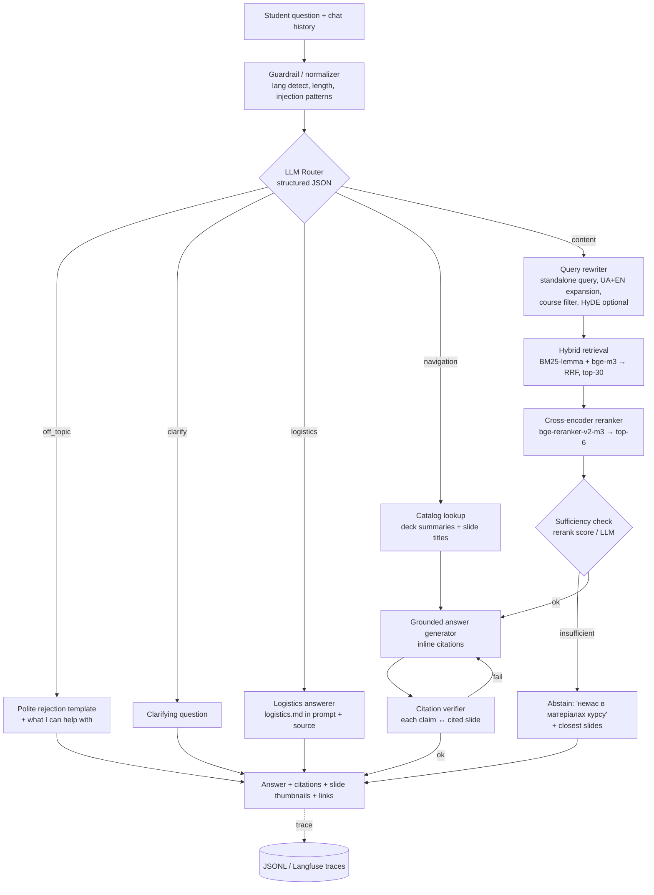

# Course Assistant — Q&A over the OS course series (Ukrainian lecture slides)

Detailed project plan for HW1 ("Build an NLP System"). This plan follows CRISP-DM. Each phase lists
its deliverables and exit criteria.

---

## 0. Findings from the sample lecture (`os_l000_intro.pdf`)

I inspected the sample deck before planning, so the design is based on the real data:

| Observation | Consequence for the pipeline |
|---|---|
| LaTeX **Beamer** output (LuaTeX), text layer is real text (no OCR needed) | Use direct text extraction (PyMuPDF), not OCR. It is fast and accurate. |
| Every page repeats a **header** (section name, e.g. "Огляд") and a **footer** (author + deck title) plus Beamer navigation icons | Strip boilerplate by bounding-box zones and by text that repeats across pages. Without this, BM25 and embeddings are polluted. |
| Slide title sits in a fixed band under the header | Extract it as structured metadata (`slide_title`). It is strong retrieval and citation signal. |
| **Hyperlinks are annotations**: visible text is "Windows NT vs. Unix: A design comparison", the URL (`blogsystem5.substack.com/...`) is only in the link annotation. Visible URLs are **truncated** ("…wiki/File:") | Extract `page.get_links()` and attach each URI to its anchor text as a Markdown link. Never rely on visible URL text. |
| **Footnotes** carry real content ("Ironically, this difference appeared as a means of virtualization…") | Keep footnotes and attach them to the slide body. |
| Figures come in two kinds: **raster** (p.11 Unix history PNG) and **vector** (p.10 Unix timeline has no embedded image, `pdfimages` misses it) | Figure detection cannot use embedded images alone. Render the **whole page** to PNG and use vector-drawing count + image count + text density heuristics to decide whether the page goes to the vision model. |
| Logos on the title slide (UCU, Applied Sciences Faculty) | Skip images by perceptual hash when they repeat across decks. |
| Empty / near-empty slides (p.13 has only a bullet) | Drop them, but keep page numbering so citations stay correct. |
| Beamer `\pause` / overlays can produce consecutive near-duplicate pages (not in this deck, but likely in longer ones) | Detect pages whose text is a prefix or subset of the next page and merge them into the last full version. Record the page range so the citation can say "слайди 14–16". |
| Mixed language: Ukrainian body with English terms (FUSE, MMU, user mode/kernel mode, RTOS, xv6, POSIX/SUS) | Retrieval must handle UA↔EN term mismatch. Use multilingual embeddings, lemmatize Ukrainian for BM25, and expand queries with both UA and EN terms. |
| Filename `os_l000_intro` = `<course>_l<index>_<slug>`; 3 consecutive, interconnected courses | Parse course, lecture index and slug from the filename into metadata. Enables course filtering, ordering ("which lecture first introduces X?"), and cross-course links. |
| License CC BY-SA, author Олег Фаренюк | Sending slides to external APIs is acceptable. Keep the attribution in the UI. |

**Scale:** about 24 decks × 40–150 slides ≈ **2,000–3,000 slides**. Expect 15–25% of them to need a vision
description, so roughly 400–700 VLM calls, done once and cached. Everything fits in memory, so no vector DB
server is needed.

---

## 1. Business Understanding (CRISP-DM phase 1)

### 1.1 Problem
Students taking the three consecutive courses (OS → … → …) need fast, trustworthy answers grounded in the
lecture materials. They also need to see *where* the answer comes from so they can study the original slide.
Generic chatbots hallucinate, ignore course-specific notation (xv6, the course's choice of POSIX/SUS vs
Windows), and cannot point to the slide.

### 1.2 Users and use cases
| ID | Use case | Example (UA) |
|---|---|---|
| UC1 | Concept question answered from the slides with citations | «Чим мікроядро відрізняється від монолітного ядра?» |
| UC2 | Question about a figure/diagram | «Що показує діаграма історії Unix? Від чого походить macOS?» |
| UC3 | Navigation / "where is it" | «У якій лекції розповідають про MMU?» |
| UC4 | Cross-lecture / cross-course synthesis | «Як ідея віртуалізації з першої лекції розвивається в наступних курсах?» |
| UC5 | Course logistics (grading, deadlines, tools, course order) | «Які ОС використовуються в курсі?», «Скільки балів за лабораторні?» |
| UC6 | External resources ("give me further reading") | «Що почитати про Windows NT vs Unix?» → returns the linked URLs |
| UC7 | Off-topic / abusive / prompt-injection: politely reject | «Напиши мені вірш про котів» |
| UC8 | Related but not covered by materials: say so and do not invent | «Як працює планувальник у FreeRTOS?» (if not in slides) |
| UC9 | Ambiguous: ask a clarifying question | «Поясни це» (no context) |

### 1.3 Scope
**In scope:** PDF → Markdown parsing, figure descriptions with a vision model, link extraction, hybrid
retrieval with reranking, an LLM router, grounded answers with slide-level citations, abstention, a
logistics knowledge card, multi-turn chat (short memory), a simple web UI, tracing, and an evaluation
suite for every component.

**Out of scope:** grading or homework solving (the router flags "solve my lab for me" as out of policy and
answers with concepts plus pointers only), fetching the content of linked web pages (links are surfaced,
not crawled), and user accounts.

### 1.4 Success criteria (targets, refined after the first eval round)
| Component | Metric | Target |
|---|---|---|
| Parser | Text token-F1 vs gold, link recall | ≥ 0.95, = 1.0 |
| Figure descriptions | Faithfulness (judge, validated) | ≥ 4/5 avg, 0 critical hallucinations on the sample |
| Router | Macro-F1; false-reject rate on in-domain questions | ≥ 0.90; ≤ 3% |
| Retrieval | Recall@5 / MRR@10 on the gold set | ≥ 0.85 / ≥ 0.70 |
| Answer | Correctness (judge 1–5); faithfulness; citation precision | ≥ 4.0; ≥ 0.90; ≥ 0.90 |
| Abstention | Correct "not in materials" on unanswerable set | ≥ 0.85 |
| System | p50 latency | < 8 s |

---

## 2. Data Understanding (CRISP-DM phase 2)

1. **Inventory script** (`scripts/inventory.py`): for every PDF it records pages, the creator (Beamer or
   other), text chars per page, embedded images, vector drawing counts, link annotations, and empty pages.
   It outputs `reports/data_inventory.md`.
2. **Manual review** of 3 decks (one per course): note layout quirks such as code listings, tables,
   formulas, two-column slides, and overlays.
3. **Existing datasets check** (required by the assignment): there is no public QA dataset for these
   lectures. Ukrainian general QA sets (e.g. UA-SQuAD) do not match the domain, so they are mentioned only.
   Decision: build a **small hand-curated + LLM-assisted gold set** from the slides (section 6.1).
4. **Logistics source:** collect the syllabus, grading rules, course order, and tools into
   `data/logistics/*.md`. If no official syllabus exists, write a clearly-marked sample one. (Open
   question Q2.)

Deliverable: `reports/data_inventory.md` with statistics and examples of each quirk.

---

## 3. Data Preparation (CRISP-DM phase 3) — ingestion pipeline (offline)

```
data/raw/*.pdf
   │  (1) PDF parser  ──────────────►  data/parsed/<deck>/slides.jsonl  +  <deck>.md
   │  (2) Page renderer ────────────►  data/parsed/<deck>/pages/p012.png
   │  (3) Figure detector ──────────►  flag needs_vision per slide
   │  (4) Vision describer (VLM) ───►  figure_description per slide (cached)
   │  (5) Chunker + metadata ───────►  data/index/chunks.jsonl
   │  (6) Indexers ─────────────────►  BM25 index (lemmatized) + dense vectors (npy/FAISS)
   └  (7) Lecture catalog ──────────►  data/index/catalog.json  (deck → title, slide titles, summary)
```

### 3.1 PDF → structured slides (PyMuPDF)
- Use `page.get_text("dict")` to keep block coordinates and font sizes.
- **Zone stripping**: drop the top band (section header) and bottom band (footer, nav icons). Calibrate
  the band heights on the 3 reviewed decks, then confirm with a "text repeated on >60% of pages" rule.
  Keep the header *section name* as metadata (`section`), since it is useful context.
- **Title**: largest font in the title band → `slide_title`.
- **Bullets**: map Beamer bullet glyphs (•, ◇, nested) to Markdown list levels.
- **Links**: `page.get_links()` → match each link rect to the overlapping span → `[anchor](uri)`.
  Also store `urls: [...]` per slide.
- **Footnotes**: small font at the bottom of the content area → `> Примітка: …`.
- **Code / monospace**: font name contains `Mono`/`Courier`/`tt` → fenced code block.
- **Overlay merge**: if `text(p_i) ⊂ text(p_{i+1})` (normalized), drop `p_i` and record `pages: [i, i+1]`.
- **Empty slides**: fewer than N meaningful chars and no figure → skip (keep the numbering).
- Output per slide (JSONL):
  ```json
  {"deck_id":"os_l000_intro","course":"os","lecture_idx":0,"lecture_title":"Що таке операційна система і навіщо вона",
   "page_start":4,"page_end":4,"section":"Огляд","slide_title":"Абстракції, які надаються ОС загального використання",
   "body_md":"- Ключовим є поняття віртуалізації. …","footnotes":["Legacy, але все ще часто незамінні."],
   "urls":[],"needs_vision":false,"figure_description":null}
  ```
- Also write a human-readable `<deck>.md` (one `## Слайд N — Title` section per slide) for review and the demo.
- **Why not docling/marker?** They target documents with OCR and layout models. They are heavier, slow on
  CPU, and add nothing for born-digital Beamer slides. We keep one as a *baseline in the parser eval*
  (pymupdf4llm) to justify the choice with numbers.

### 3.2 Figure detection and vision descriptions
- Render each page at about 150 DPI (`page.get_pixmap`).
- `needs_vision = True` if any of these hold: a non-logo raster image covers > 10% of the page;
  `len(page.get_drawings()) > T` (vector diagrams such as the timeline on p.10); or text density is low
  while the content area is non-empty. Tune T on the reviewed decks.
- **VLM prompt** (Ukrainian output, English technical terms kept as they are): send the page image **plus
  the extracted slide text**, so the model describes only what the text does not already say. Ask for:
  (a) diagram type, (b) the entities, labels and arrows/relations, (c) the key takeaway in 1–2 sentences,
  (d) verbatim labels list (for BM25). Instruct it to say "нерозбірливо" rather than guess.
- Mark the result as `[Опис зображення, згенеровано моделлю]` in the chunk, so the answer generator and the
  user know it is model-derived. Citations to it are labelled "(рисунок)".
- Cache by `sha256(image_bytes + prompt_version + model)` in `data/cache/vlm/`. The build is re-runnable
  and costs nothing on reruns.

### 3.3 Chunking
- **Unit = one slide** (after overlay merge). Slides are short, self-contained and map directly to citations.
- Chunk text = `Курс › Лекція N: title › Розділ › Заголовок слайду` breadcrumb + body + footnotes +
  figure description + link anchors.
- If consecutive slides share a title (continued slides "… (продовження)"), also create a merged
  **window chunk** that points to both slides. This helps questions that span a split slide.
- **Deck-summary chunk** per lecture (LLM-generated from its slide titles + bodies), used for navigation
  (UC3) and cross-course questions (UC4).

### 3.4 Indexing
- **Dense:** `BAAI/bge-m3` (multilingual, strong on Ukrainian, runs on CPU for about 3k chunks in minutes).
  Alternative for comparison: `intfloat/multilingual-e5-large`. Vectors go in NumPy/FAISS flat; no server.
- **Sparse:** BM25 (`rank_bm25`) over **lemmatized** Ukrainian (`pymorphy3` + `pymorphy3-dicts-uk`;
  fallback: Snowball-style stemmer). Ukrainian is highly inflected («ядра», «ядром», «ядрі»), so lemmatization
  matters. English terms stay lowercase as they are.
- **Glossary** (`data/glossary.yaml`): UA↔EN term pairs (віртуалізація↔virtualization,
  мікроядро↔microkernel, планувальник↔scheduler…). Seed it automatically from slide terms with an LLM,
  then review by hand. Used for query expansion.

---

## 4. Modeling (CRISP-DM phase 4) — online question-answering system

### 4.1 Data flow diagram



### 4.2 Components (purpose, input, output, model/tool calls)

| # | Component | Purpose | Input | Output | Calls |
|---|---|---|---|---|---|
| C1 | PDF parser | Clean structured slides from Beamer PDFs | PDF | `slides.jsonl`, `.md` | PyMuPDF (tool) |
| C2 | Figure detector + VLM describer | Make diagrams searchable and citable | page PNG + slide text | description text | **VLM call** (cached) |
| C3 | Chunker / indexer | Retrieval units + indexes | slides | chunks, BM25, vectors, catalog | bge-m3 (local model), pymorphy3 |
| C4 | Guardrail / normalizer | Cheap pre-filter: empty, too long, obvious injection, language | raw text | normalized text, flags | regex, `langdetect` |
| C5 | **Router** | Decide the route: `content`, `logistics`, `navigation`, `clarify`, `off_topic` (+ `course` hint, + `needs_history`) | question + last turns + course list | JSON `{route, course, confidence, reason}` | **LLM call** (small model, JSON schema, few-shot) |
| C6 | Query rewriter | Make the follow-up standalone, add UA/EN terms from the glossary, set course filter | question + history | 1–3 search queries + filters | **LLM call** + glossary lookup |
| C7 | Hybrid retriever | High-recall candidate set | queries | top-30 chunks | BM25 + dense, Reciprocal Rank Fusion |
| C8 | Reranker | Precision at the top | query + 30 chunks | top-6 with scores | `bge-reranker-v2-m3` (local cross-encoder) |
| C9 | Sufficiency gate | Decide answer vs abstain | rerank scores (+ LLM yes/no if borderline) | bool | threshold; optional **LLM call** |
| C10 | Answer generator | Ukrainian answer, grounded, with `[os_l000, сл. 7]` style citations | question + top-k chunks (with IDs) | answer + cited IDs | **LLM call** |
| C11 | Citation verifier | Catch unsupported sentences and wrong citations | answer sentences + cited chunks | pass/fail per sentence | **LLM call** (NLI-style judge) or a cheaper multilingual NLI model |
| C12 | Logistics answerer | Answer from the curated logistics card, without RAG | question + `logistics.md` | answer + source file/section | **LLM call** |
| C13 | Navigation | "Where/which lecture" via the catalog | question | ranked decks/slides | catalog search (+ C10 formatting) |
| C14 | UI + tracing | Chat, rendered citations (click → slide image / `pdf#page=N`), external links, debug panel with route/retrieved chunks/scores | — | — | Streamlit; JSONL traces (optionally Langfuse) |

**Why a router instead of always retrieving?** Logistics and off-topic questions retrieve noise and
produce confident nonsense. Navigation questions need deck-level info, not slide chunks. The router also
gives a measurable classification step.

**Router design:** a single LLM call with JSON-schema output and around 15 few-shot examples covering all
labels, including tricky ones: "Як встановити Linux?" is borderline and goes to *content* if the course
covers it, otherwise *off_topic* or abstain; "Розв'яжи лабу 3 за мене" → policy reply. Fallback if the LLM
fails: an embedding nearest-centroid classifier trained on the router dev set. That classifier is also
reported as a **baseline** in the router eval.

**Citations format:** inline `[ОС·Л0·сл.6]` → rendered as a link to the slide thumbnail/PDF page. The
"Джерела" list at the end shows lecture title, slide title, and any external URLs from those slides. The
generator receives chunks with stable IDs and may cite **only** those IDs; IDs outside the list are
stripped and counted as an error.

**Multi-turn:** keep the last 4 turns. The rewriter makes follow-ups («а в Windows?») standalone.

### 4.3 Model choices (configurable in `config.yaml`, provider = OpenRouter-compatible API)
- **Router / rewriter / verifier:** small, fast model with good Ukrainian and JSON mode.
- **Generator:** stronger model (Ukrainian fluency + instruction following for citations).
- **VLM:** a vision-capable model (Gemini-Flash-class, Qwen-VL-class, or Claude Haiku/Sonnet 5.5). Used offline
  only, so a stronger model is acceptable. Pick by the C2 eval on 30 figure slides.
- **Local:** `bge-m3` embeddings and `bge-reranker-v2-m3` (CPU OK, no GPU on this machine).
- Free OpenRouter models are acceptable (CC BY-SA content), but rate limits make **caching all LLM calls**
  mandatory. All model IDs live in config, never in code.

---

## 5. Prompts (versioned in `prompts/*.md`, each with `version:` header)
`router.md`, `rewrite.md`, `answer.md`, `verify.md`, `vlm_figure.md`, `logistics.md`, `deck_summary.md`,
`judge_*.md`. The prompt version is logged in every trace and eval result, so score changes can be
attributed to prompt changes.

---

## 6. Evaluation (CRISP-DM phase 5) — every component

### 6.1 Gold datasets (`eval/data/`, Ukrainian, ~250 items total)
| Set | Size | How built | Labels |
|---|---|---|---|
| `parse_gold` | 40 slides (stratified: text, code, figure, links, footnotes, overlays) | hand-corrected Markdown | gold text, gold links, gold title |
| `figure_gold` | 30 figure slides | human notes: key entities + takeaway | entity list, takeaway |
| `router_set` | 150 questions | ~30 per class: hand-written + LLM-paraphrased, then human-reviewed. Includes hard negatives (generic CS questions, other OS courses, injection) | route label |
| `qa_set` | 120 questions | 60 single-slide (LLM-generated from a random slide, then paraphrased to **avoid lexical copying**, then human-filtered), 20 figure-based, 20 multi-slide/cross-lecture, 20 hand-written "real student" questions. ~15% in English or mixed language | gold slide IDs, reference answer, key facts |
| `unanswerable_set` | 25 | on-topic OS questions **not** covered in the slides (verified by search) | expected abstain |
| `logistics_set` | 20 | from `logistics.md` | key facts |

Split: dev (tuning prompts, thresholds) / test (reported once per iteration). This prevents tuning on the test set.

### 6.2 Metrics per component
| Component | Metrics | Method |
|---|---|---|
| C1 Parser | token-F1 and CER vs gold text; title accuracy; **link recall/precision** (vs PDF annotations, fully automatic); boilerplate leakage rate (header/footer strings left in chunks); overlay-merge precision | automatic vs `parse_gold`; **baseline: pymupdf4llm** raw output |
| C2 Figure descriptions | entity recall vs gold entity list; faithfulness 1–5 (judge, sees the image); critical hallucination count; **downstream ablation:** Recall@5 on the 20 figure questions *with vs without* descriptions | judge + automatic |
| C3 Index / embeddings | compare bge-m3 vs multilingual-e5 vs BM25 only | via retrieval metrics below |
| C5 Router | accuracy, macro-F1, per-class P/R, confusion matrix, **false-reject rate** (in-domain → off_topic, the worst error), latency | automatic; baseline = embedding classifier |
| C6 Rewriter | retrieval Recall@5 with vs without rewriting; follow-up subset (multi-turn) | ablation |
| C7+C8 Retrieval | Recall@{1,5,10}, MRR@10, nDCG@10 | automatic vs gold slide IDs; **ablation table:** BM25 / dense / hybrid-RRF / hybrid+rerank / +glossary expansion |
| C9 Sufficiency gate | abstention precision/recall on `unanswerable_set` + answerable `qa_set`; threshold sweep curve | automatic |
| C10 Generator | **answer correctness** (judge 1–5 vs reference + key-fact recall); **faithfulness** (share of claims supported by retrieved chunks); **citation precision** (cited slide supports the sentence) and **citation recall** (supported sentences that carry a citation); language correctness (answers in Ukrainian) | LLM judge with rubric + claim decomposition |
| C11 Verifier | catches injected errors: add deliberately wrong citations or fabricated sentences to 30 answers and measure detection rate | synthetic perturbation test |
| C12 Logistics | key-fact accuracy, source cited | automatic + judge |
| E2E | end-to-end success = right route ∧ (correct answer ∨ correct abstain); latency p50/p95; tokens/cost per question | aggregate |

### 6.3 Making LLM-as-judge trustworthy
- Fixed rubric with **anchored examples** for 1, 3 and 5 scores in the prompt. The judge model differs from
  the generator model.
- **Calibration:** I hand-label 40 answers. Report Cohen's κ (binary faithful / not) and Spearman ρ
  (1–5 correctness) between the judge and me. If κ < 0.6, revise the rubric.
- Inspect the low-score items by hand and write an error taxonomy: retrieval miss / wrong chunk ranked
  first / parsing loss / figure description wrong / generator ignored context / judge error. This answers
  the assignment's "explain why scores are not as good as they could be".

### 6.4 Outputs
`python -m eval.run --component all` → `reports/eval/<date>_<git-sha>.json` + `reports/eval/summary.md`
(tables, confusion matrix PNG, ablation table, error analysis). Every iteration adds a row to
`reports/eval/history.md` (what changed → metric deltas). This row is the evidence of CRISP-DM iteration.

---

## 7. Deployment (CRISP-DM phase 6)
- `make ingest` (or `python -m app.ingest data/raw`), then `make index`, then `streamlit run app/ui.py`.
- `.env.example` with `OPENROUTER_API_KEY`; `config.yaml` for models and thresholds.
- Optional `Dockerfile`. Tracing: JSONL in `logs/traces/` by default, with optional Langfuse
  (self-hosted / cloud) toggle for the demo video.
- The UI debug sidebar shows the route, rewritten queries, retrieved chunks with scores, verifier results,
  and latency. Useful for the video walkthrough.

---

## 8. Repository layout

```
HW1/
├── AGENTS.md                  # conventions for coding agents (CRISP-DM rules, quality gates) — symlinked as CLAUDE.md
├── PLAN.md                    # this file
├── README.md                  # setup, run, demo instructions
├── config.yaml / .env.example
├── .claude/skills/            # project skills (section 9)
├── data/
│   ├── raw/                   # source PDFs (os_l000_intro.pdf, …)
│   ├── logistics/             # syllabus / grading / course order (.md)
│   ├── glossary.yaml
│   ├── parsed/  index/  cache/   # generated, git-ignored
├── app/
│   ├── ingest/  parser.py  figures.py  vlm.py  chunker.py  indexer.py  catalog.py
│   ├── pipeline/ guard.py  router.py  rewrite.py  retrieve.py  rerank.py  gate.py  generate.py  verify.py  logistics.py  navigate.py
│   ├── llm.py                 # single client: caching, retries, tracing, JSON mode
│   ├── schemas.py             # pydantic models (Slide, Chunk, RouteDecision, Answer, Citation)
│   └── ui.py
├── prompts/
├── eval/  data/  run.py  metrics.py  judge.py  build_gold.py
├── reports/  data_inventory.md  eval/  report.md (final report: diagram, business logic, results)
├── scripts/ inventory.py
└── tests/                     # unit tests (parser on sample PDF, citation parsing, RRF, metrics)
```

---

## 9. Agentic development setup (graded: "use of AI coding assistant")

### 9.1 `AGENTS.md` (also `CLAUDE.md` → symlink), key content
- **Project goal and scope** (short form of section 1) and a pointer to `PLAN.md` as the source of truth.
- **CRISP-DM rules:** every task states which phase it belongs to. No modeling change without an eval run
  before and after. Every change that affects metrics appends to `reports/eval/history.md`. Data
  understanding findings go into `reports/data_inventory.md`, not into chat.
- **Conventions:** Python 3.12, `uv` for deps, typed code, pydantic schemas at component boundaries,
  `ruff` + `pytest` must pass. One component per module with a pure `run(input) -> output` function so it can
  be evaluated in isolation.
- **LLM rules:** all LLM calls go through `app/llm.py` (cache + trace). Prompts live in `prompts/` with
  version headers, never inline. Model IDs only in `config.yaml`. Never commit keys.
- **Language rule:** user-facing text in Ukrainian; code, comments and docs in English.
- **Data rules:** never edit `data/raw`. Generated data is reproducible from scripts. Gold eval data is
  hand-reviewed, and agents must not regenerate or "fix" `eval/data/*test*` to raise scores.
- **Definition of done:** tests pass, component eval runs, README updated if the CLI changed.
- **Context hygiene:** what to read first for each kind of task (e.g. parser work → `app/ingest/parser.py`,
  `tests/test_parser.py`, `data/parsed/os_l000_intro/os_l000_intro.md`). Do not read `data/index` or caches.

### 9.2 Skills (`.claude/skills/<name>/SKILL.md`)
| Skill | What it does |
|---|---|
| `inspect-deck` | Run the parser on one PDF, render chosen pages, and compare extracted Markdown against the page images. Report quirks. (Used in Data Understanding and parser debugging.) |
| `run-eval` | Run the eval for a given component on dev/test, diff against the last entry in `history.md`, and append a row with the change description. |
| `error-analysis` | Take the lowest-scoring eval items and classify them by the error taxonomy (6.3). Propose the single most impactful fix. |
| `add-gold-items` | Generate candidate QA/router items from given slides following the dataset rules (paraphrase, no lexical copy, labels). Writes them to a *review* file for human approval, never directly to the test set. |
| `prompt-iteration` | Bump a prompt version, run the relevant component eval, and keep or revert based on the metric. |
| `trace-debug` | Load a trace by ID and walk through route → queries → retrieved → answer → verifier, pointing out where it went wrong. |
| `crisp-dm-report` | Update `reports/report.md` sections from the current eval summary, diagrams and history. |

### 9.3 Reflection material for the video
Keep `reports/agent_log.md`: brief notes on what context was given to the agent, where it went wrong,
and which rule was added to `AGENTS.md` as a result.

---

## 10. Milestones

| # | Milestone | CRISP-DM | Exit criterion |
|---|---|---|---|
| M0 | Repo skeleton, `AGENTS.md`, skills, config, `llm.py` with cache/trace | — | `pytest` green, one dummy LLM call is traced |
| M1 | Inventory + manual review of 3 decks | Data understanding | `data_inventory.md` |
| M2 | Parser + overlay/link/footnote handling, `parse_gold` | Data prep + eval C1 | parser metrics ≥ targets vs baseline |
| M3 | Figure detection + VLM descriptions, `figure_gold` | Data prep + eval C2 | faithfulness ≥ 4, model chosen |
| M4 | Chunking, BM25+lemma, bge-m3, catalog, glossary | Data prep | indexes built from scratch in one command |
| M5 | Gold QA/router/unanswerable/logistics sets | Evaluation design | sets reviewed, dev/test split frozen |
| M6 | Retrieval + reranker + ablation | Modeling + eval C7/C8 | Recall@5 ≥ 0.85 |
| M7 | Router, rewriter, gate, generator, verifier, logistics, navigation | Modeling + eval | all component evals run |
| M8 | Streamlit UI + debug panel + tracing | Deployment | demo cases UC1–UC9 work |
| M9 | Judge calibration, error analysis, 1–2 improvement iterations | Evaluation → back to modeling | `history.md` shows deltas |
| M10 | `report.md` (diagram, business logic, eval results), README, video | Deployment | submission ready |

---

## 11. Risks and mitigations
| Risk | Mitigation |
|---|---|
| Free-model rate limits / instability | Cache everything. Use a provider-agnostic client with fallback model list. Run the offline VLM pass once. |
| Weak Ukrainian in small models | Pick models by router/answer eval. Use few-shot prompts in Ukrainian. |
| VLM hallucinating diagram details | Pass the slide text along with the image, require "нерозбірливо" for unclear parts, label descriptions as model-generated, and measure faithfulness. |
| Synthetic QA too easy (lexical overlap with slides) | Paraphrase step + hand-written questions + report metrics separately for synthetic and hand-written. |
| Judge bias (same model grading itself) | Use a different judge model and calibrate against human labels. |
| Cross-course naming ambiguity («Лекція 3» of which course?) | Router extracts a course hint. Citations always include the course prefix. |

---

## 12. Open questions for you
1. **Other two course prefixes and names** (e.g. `os_…`, `?_…`, `?_…`) and their order. Is there a single
   naming pattern for all ~24 files?
2. **Logistics source:** is there an official syllabus/grading doc to include, or should I write a
   clearly-marked sample `logistics.md`?
3. **LLM budget:** only free OpenRouter models, or is a paid key (small budget) available? This mostly
   affects VLM quality and judge reliability.
4. **UI preference:** Streamlit (default) or Gradio?
5. Should answers be **strictly** from the slides, or may the model add general OS knowledge if it is clearly
   marked «поза матеріалами курсу»? Default: strictly from slides + abstain.
