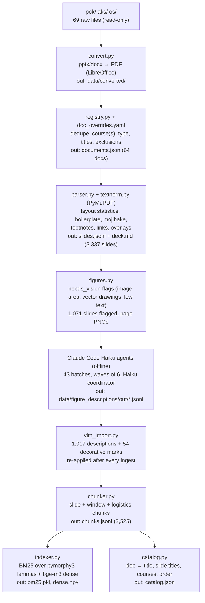
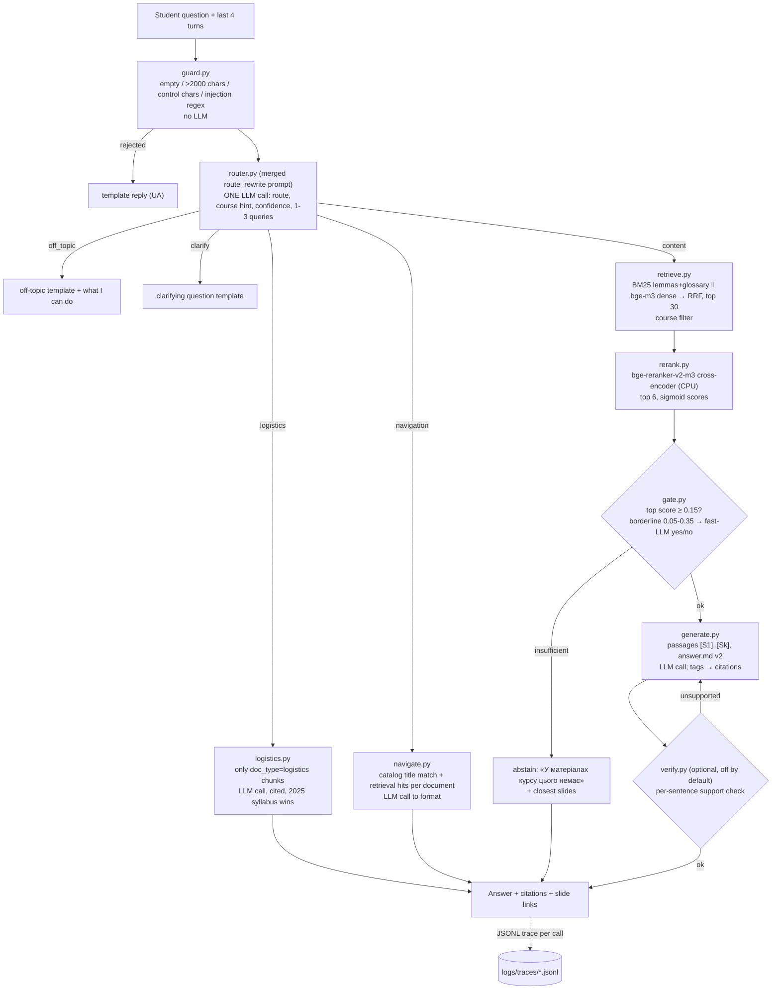
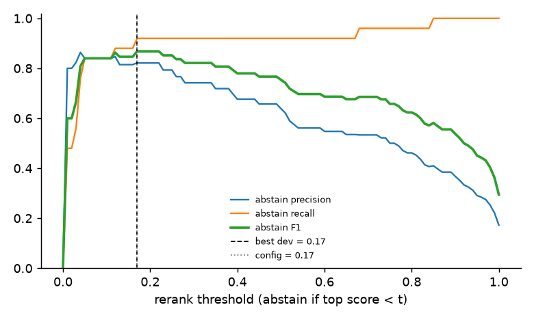

# Course Assistant: grounded Ukrainian Q&A over the ПОК / АКС / ОС lecture materials

HW1 "Build an NLP System", final report. Structure follows CRISP-DM (sections 1-6) plus the agentic-development section (7), which is graded separately.

Conventions used throughout:
- Every number comes from a file in this repo. The source (file, split, n, run_id) is given next to it. Appendix B lists the command that reproduces each table.
- "Not measured — <reason>; future work" marks a metric that was planned but never run, with the reason. Such items are collected in section 8 (Limitations / not measured). Nothing unmeasured is estimated.
- "Orchestrator measurement, 2026-11-15" marks facts measured interactively by the orchestrating agent that are not yet in a result file.
- Corpus counts (documents, slides, chunks) are recounted from `data/parsed/documents.json`, `data/parsed/*/slides.jsonl` and `data/index/chunks.jsonl` (current index, rebuilt with figure descriptions).
- **All gold sets are unreviewed drafts** (see 5.1). Every score below is provisional until a human reviews the gold.

---

## 0. Summary

**What it does.** A Streamlit chat app for students of three consecutive courses (ПОК, АКС, ОС). It answers in Ukrainian *only* from the course materials (64 documents, 3,337 slides: lectures, labs, syllabi), cites the slide for each statement, and abstains with «У матеріалах курсу цього немає» when the slides do not support an answer. It also answers logistics questions (grading, deadlines) from the syllabi, tells students which lecture covers a topic, asks a clarifying question for vague input, and rejects off-topic or injection attempts.

**Why it is not vanilla RAG.** The pipeline has a guard, a merged LLM router and query rewriter (5 routes), hybrid lexical+dense retrieval with a cross-encoder reranker, a score-based sufficiency gate that decides *before generation* whether to abstain, an optional citation verifier with regeneration, a separate logistics path with a document-precedence rule, and a catalog-based navigation path. Figure-heavy slides are made searchable by model-written descriptions (1,017 slides). Each of these components has its own evaluation.

**Headline metrics** (details and caveats in section 5):

| Component | Metric | Result | Target (PLAN §1.4) | Split, n, run | Status |
|---|---|---|---|---|---|
| Parser | token-F1 vs gold | 0.895 (baseline pymupdf4llm 0.706) | ≥ 0.95 | parse_gold draft, n=40, `parser_2026-11-15.json` | below target |
| Parser | link recall (gold / all docs) | 1.000 / 1948 of 1948 URIs | = 1.0 | same; all 57 documents with links | met |
| Parser | boilerplate leakage | 0.000 (baseline 0.475) | n/a | same | n/a |
| Figure descriptions | entity recall, non-decorative | recall 0.856 [0.759, 0.935]; faithfulness 4.74/5, 26 of 27 ≥ 4 (96%), 0 critical hallucinations | faithfulness ≥ 4/5, 0 critical hallucinations | figure_gold draft, n=27, `judgments_figure.jsonl` | faithfulness met (Haiku described and judged, same family, no human check) |
| Router | accuracy | 0.950 [0.850, 1.000] (TF-IDF+LogReg baseline 0.650) | macro-F1 ≥ 0.90 | router draft, dev, n=20, `2026-11-15_nogit_dead0146_small` | macro-F1 0.949, met |
| Router | false-reject rate | 0.000 (n=12 in-domain items) | ≤ 3% | same | met |
| Router | latency p50 / p95 | 10.0 s / 128.7 s | system p50 < 8 s | same | p50 above target; p95 dominated by free-model congestion |
| Retrieval | Recall@5, MRR@10 | 0.958 [0.917, 0.992], 0.905 [0.861, 0.946] (hybrid + glossary + rerank 10/256; R@1 0.850 [0.783, 0.908]) | ≥ 0.85, ≥ 0.70 | qa draft, n=120, course filter, no LLM, `retrieval_2026-11-15_dev.json` | met (draft gold; one gold id missing from the index) |
| Gate | abstain precision / recall at threshold 0.17 | P 0.821, R 0.920 (F1 0.868); false-abstain 0.042 | ≥ 0.85 | dev, qa draft (120) + unanswerable draft (25), n=145, gate v1 | recall meets target, precision does not; threshold tuned and scored on the same dev set |
| Answer | correctness, faithfulness, citation precision | 3.67 [2.92, 4.33]; 0.915 [0.81, 0.98] (claim level); 0.833 [0.71, 0.93] | ≥ 4.0; ≥ 0.90; ≥ 0.90 | dev, small preset, qa draft n=12 (+5 unanswerable: 5/5 abstained), answer v2 | correctness and citation precision below target; faithfulness meets it |
| Logistics | key-fact recall; source document cited; correctness (judge 1-5) | 0.533 [0.267, 0.800]; 0.800 [0.400, 1.000]; 3.2 [2.0, 4.4] (claim faithfulness 0.727, n=11 claims) | n/a | logistics draft, n=5 (small), `2026-11-15_logistics_dev.json` | weak; interval very wide |
| Verifier | detection rate on injected errors | not measured (n=1 anecdote: the injected fabricated claim was detected) | n/a | 1 of 5 planned perturbed items; run stopped, all three free models returned 429 repeatedly | not measured; blocked by free-model rate limits |
| End-to-end | success rate; latency p50 / p95 | 0.773 [0.591, 0.909] (qa 0.750 n=12, unanswerable 1.000 n=5, logistics 0.600 n=5); 57 s / 146 s | p50 < 8 s | small preset, n=22, `2026-11-15_e2e_dev.json` | latency target not met (free-model queueing) |

> Items that were never run (judge calibration, figure-description ablation, bge-m3 vs. e5, full router set and frozen test split, verifier beyond n=1) are listed in section 8 with the reason. Conclusions against the PLAN §1.4 targets are at the end of section 8.

**How to run.** See `README.md`: `uv sync`, put the key in `.env`, `make convert ingest index`, `make ui`.

---

## 1. Business understanding

### 1.1 Problem and users
Students of three consecutive courses (ПОК → АКС → ОС) need fast answers that point to the exact lecture slide so they can study the original. Generic chatbots hallucinate, ignore course-specific notation and cannot cite a slide. Course logistics are scattered over three syllabi and a requirements deck whose numbers have changed between years.

Users: students (primary); teaching staff (secondary, to check what the materials say).

### 1.2 Use cases (PLAN.md §1.2)

| ID | Use case | Route | Example |
|---|---|---|---|
| UC1 | Concept question with slide citations | content | «Чим мікроядро відрізняється від монолітного ядра?» |
| UC2 | Question about a figure or diagram | content (uses figure descriptions) | «Що показує діаграма історії Unix?» |
| UC3 | Navigation, "which lecture covers X" | navigation | «У якій лекції розповідають про MMU?» |
| UC4 | Cross-lecture / cross-course synthesis | content (window chunks, several slides) | «Як ідея віртуалізації розвивається в наступних курсах?» |
| UC5 | Logistics (grading, deadlines, tools) | logistics | «Скільки балів за проект в ОС?» |
| UC6 | Further reading from links on slides | content (URLs kept in chunks) | «Що почитати про Windows NT vs Unix?» |
| UC7 | Off-topic, abusive, prompt injection | guard / off_topic | «Напиши мені вірш про котів» |
| UC8 | Related but not covered by the materials | gate → abstain | «Як працює планувальник у FreeRTOS?» |
| UC9 | Ambiguous input | clarify | «Поясни це» |

### 1.3 Scope
In scope: PDF/PPTX → Markdown parsing, figure descriptions, link extraction, hybrid retrieval with reranking, LLM router, grounded answers with slide citations and abstention, logistics from syllabi, catalog navigation, short chat memory (4 turns), Streamlit UI, tracing, per-component evaluation.

Out of scope: grading or solving homework (see policy below), crawling the content of linked web pages (links are surfaced, not fetched), user accounts, paid-model runtime.

### 1.4 Business rules actually kept

| Rule | Where it is enforced | Source |
|---|---|---|
| **Strictly grounded answers.** No general-knowledge fallback; every factual sentence carries `[Sx]` tags; unknown tags are stripped and counted. If the passages do not cover the question, the model must reply with the single line «У матеріалах курсу цього немає». | `prompts/answer.md` v2 rules 1-3; `app/pipeline/generate.py` | AGENTS.md §2 |
| **Abstain before generating** when the best rerank score is below the threshold (0.15; the borderline band 0.05-0.35 asks the fast LLM). | `app/pipeline/gate.py`, `config.yaml: gate` | PLAN §4 |
| **Logistics only from the syllabi and the requirements deck** (`doc_type == logistics`, 4 documents), always with the source document cited. | `app/pipeline/logistics.py`; `data/doc_overrides.yaml` | AGENTS.md §2 |
| **The 2025 syllabus wins on conflicts.** The 2020/2021 requirements deck is excluded as superseded; the logistics prompt prefers the 2025 syllabus. See the trace in 4.3. | `doc_overrides.yaml` (`cc_2020_2021_requirements_3ed: exclude`), `prompts/logistics.md` v2 | `reports/review/os.md` #8, `pok.md` #11 |
| **Homework policy.** "Solve my lab for me" is not answered with a solution; the assistant explains concepts and points to slides. | router prompt and answer rules | PLAN §1.3 |
| **Ukrainian UI and answers**; English technical terms kept as is (MMU, fork(), POSIX). Code, docs and reports in English. | prompts, `app/ui.py` | AGENTS.md §6 |
| **Runtime uses free models only** (`:free` suffix). No paid fallback exists anywhere in `config.yaml`. When the daily quota (about 50 requests per account) is exhausted or providers are congested, the UI shows a Ukrainian banner: change the API key or wait for the reset. It never silently switches to a paid model. | `config.yaml: llm.models/fallbacks`, `app/llm.py` (`QuotaError`), `app/ui.py`, `app/pipeline/answer.py` (`QUOTA_REPLIES`) | AGENTS.md §2 (user decision, 2026-11-15) |
| **Raw course folders are read-only.** | AGENTS.md §2 | |

### 1.5 Success criteria vs. targets
Targets are the PLAN.md §1.4 table. Measured values are in section 5; the headline table in section 0 already compares them.

| Component | Metric | Target |
|---|---|---|
| Parser | text token-F1; link recall | ≥ 0.95; = 1.0 |
| Figure descriptions | faithfulness (judge); critical hallucinations | ≥ 4/5; 0 on the sample |
| Router | macro-F1; false-reject rate | ≥ 0.90; ≤ 3% |
| Retrieval | Recall@5 / MRR@10 | ≥ 0.85 / ≥ 0.70 |
| Answer | correctness; faithfulness; citation precision | ≥ 4.0; ≥ 0.90; ≥ 0.90 |
| Abstention | correct "not in materials" on the unanswerable set | ≥ 0.85 |
| System | p50 latency | < 8 s |

The p50 latency target was set when paid fast models were assumed. With free models it is not realistic (router alone: p50 10.0 s; one grounded answer 20-70 s in the smoke test). See section 8.

---

## 2. Data understanding

### 2.1 The corpus
Counts below are recounted from the current files; the per-document table and quirk list are in `reports/data_inventory.md` (generated by `scripts/inventory.py`).

| Quantity | Value | Source |
|---|---|---|
| Documents | **64** (69 raw files after de-duplication and 3 explicit exclusions) | `data/parsed/documents.json` |
| Types | lecture 54, lab 5, logistics 4, other 1 | same |
| Documents per course (a shared deck counts for each course) | АКС 18, ОС 24, ПОК 29 | `reports/data_inventory.md` §1 |
| Pages → slides | 3,447 pages → **3,337 slides** (4 overlay merges, 106 empty pages dropped) | `data/parsed/ingest_stats.json`; sum of `data/parsed/*/slides.jsonl` |
| Slides flagged for vision after import | 1,017 with a description; 54 more marked decorative (`vision_reason: decorative (vlm)`) | `slides.jsonl` |
| Chunks | **3,525** = 3,274 slide + 188 window + 63 logistics | `data/index/chunks.jsonl`, field `kind` |
| Untitled slides | 411 (genuinely untitled Beamer frames) | `reports/data_inventory.md` |
| Slides with external links | 896 slides, 2,575 link annotations (1,948 distinct page-URI pairs) | same |
| Formats | LaTeX Beamer (pdfTeX, LuaTeX, MiKTeX), PowerPoint exports, LibreOffice Impress, Google Docs and Writer syllabi, Inkscape SVG-to-PDF | same |
| Languages | Ukrainian, with English third-party decks and Russian literature lists | same |

Existing datasets were checked: there is no public QA set for these lectures. General Ukrainian QA corpora (e.g. UA-SQuAD) do not match the domain, so they are mentioned only. The gold sets are therefore built from the slides (5.1).

### 2.2 Quirks found, and the decision each led to
Found by three Haiku review agents (one per course folder, `reports/review/{pok,aks,os}.md`) and measured by `scripts/inventory.py`. The full 17-row table is in `reports/data_inventory.md` §3; the ones that shaped the design:

| Quirk | Evidence | Decision |
|---|---|---|
| cp1251 mojibake (`Ìîòèâàöiÿ` for `Мотивація`) from Type 3 fonts without ToUnicode | 84,780 characters in 7 documents, 328 pages, measured before normalization | `app/ingest/textnorm.py` repairs it (also word-level partial mojibake) |
| Latin `i`/`I` inside Ukrainian words | 12,422 characters in 29 documents | `textnorm.fix_latin_i`; English words and code are untouched |
| Beamer navigation bar and footer repeated on every page | all Beamer decks | text repeated on > 50% of pages inside the header/footer bands is boilerplate; the section name is kept as metadata |
| Footnote markers glued to words (`балів25`) | requirements deck, `os_l025_signals` | superscript spans smaller than 0.8 of the line font are dropped; footnotes captured separately |
| Overlays (`\pause` builds) give near-identical consecutive pages | `cc_l00` p.48-50, `os_l033_async` p.45-51 | merge by title and text containment (4 merges in the corpus) |
| Figures are often vector drawings, not images | `os_l000_intro` p.10 has no embedded image | figure flags use vector-drawing count relative to the document median, image area, and low text |
| PowerPoint exports split justified lines into per-word spans; large body font looks like a heading | `Lek_*_2018` | lines rebuilt by baseline; pages where most lines are heading-sized have no headings |
| Beamer bullets are tiny images or glyphs | `os_l000_intro` p.4 | bullet images from `get_image_info()`, glyph depth gives list nesting |
| Code in LuaTeX decks is set in Times, not monospace | `cc_l50` p.34, `cc_l60` p.39 | **accepted limitation**: not fenced, still searchable |
| Duplicate decks across course folders | 5 duplicate groups | one document with all courses; the cleanest, newest copy is parsed |
| Conflicting grading schemes for the same course (2025 syllabus, 2024/2025 requirements, 2020/2021 requirements, `Lec_1_OS` p.10) | `reports/review/os.md` #8, `pok.md` #11 | logistics from the 3 syllabi plus the 2024/2025 deck; the 2020/2021 deck excluded |
| Mixed languages and third-party decks | `Presentation1-4`, `Realtime_OS__*` | kept (course material); catalog titles marked «(англ.)» |

### 2.3 Registry decisions (`data/doc_overrides.yaml`)
Curated by hand from the review findings; summary of the effects:

| Effect | Entries | Reason |
|---|---|---|
| `doc_type: logistics` with a stable `doc_id` | 3 syllabi + requirements 2024/2025 | only these feed the logistics route |
| `exclude: true` | `cc_2020_2021_requirements_3ed`, `Lec_3_OS`, `cpp_CourseProjectPresentation` | superseded numbers; identical earlier subset of `Lec_7`; student project, not course material |
| hand-written `title` | most decks | PDF metadata titles missing or wrong |
| `order` | `Lec_7`, GUI decks, `Presentation*`, `Realtime_OS__*`, FS | gives the catalog a sensible lecture order |
| `courses: [pok, aks, os]` | intro deck, requirements deck | shared across the three courses |

---

## 3. Data preparation

### 3.1 Ingestion pipeline (offline)



| Step | Input | Output | Model or tool |
|---|---|---|---|
| convert | `.pptx/.docx` | `data/converted/<course>/*.pdf` | LibreOffice (tool) |
| registry | raw files + overrides | `data/parsed/documents.json`: 64 documents | hashing, rules, hand overrides |
| parser | one PDF | `slides.jsonl` + `<doc>.md` (3,337 slides in total) | PyMuPDF, no model |
| figure flags | slides + PDF | `needs_vision`, `vision_reason`, page PNG | PyMuPDF heuristics |
| figure descriptions | page image + extracted slide text | `figure_description` (type / elements / takeaway / verbatim labels) | Claude Code Haiku agents, `prompts/vlm_figure.md` v1 |
| import | agent JSONL | `slides.jsonl` updated; decorative slides get `needs_vision=false`, reason `decorative (vlm)` | script |
| chunker | `slides.jsonl` | `data/index/chunks.jsonl` (3,525 chunks) | script |
| indexer | chunks | BM25 (lemmas) + dense vectors (bge-m3, max seq len 256) | pymorphy3, `BAAI/bge-m3` (local CPU) |
| catalog | slides + registry | `catalog.json` | script |

Dense encoding took about 35 minutes on CPU (Sonnet agent brief; not re-timed).

**Figure pass.** `data/figure_descriptions/out/*.jsonl` holds 1,071 lines; `slides.jsonl` now has 1,017 slides with a description and 54 marked decorative (1,017 + 54 = 1,071). Orchestrator measurement, 2026-11-15: coverage 100%, 3 malformed (rejected by the importer's format check, which requires `Тип:` and `Висновок:`), 43 batch files, Haiku agents in waves of 6, the last 18 batches dispatched by a Haiku coordinator agent. The workers noticed and flagged dozens of errors printed on the source slides (wrong arithmetic, mislabelled chips, truth tables with missing rows) and described them as printed, without correcting them. The tracked output files, not an API, are the source of truth, so the pipeline is reproducible without re-running any LLM.

### 3.2 Worked example: one slide before and after
Slide 10 of `os_l000_intro` (the Unix timeline, a vector diagram with no embedded image). Source: `data/parsed/os_l000_intro/os_l000_intro.md` and its `slides.jsonl`.

| Stage | What the pipeline holds |
|---|---|
| Raw `pdftotext` | `Огляд` (Beamer navigation) + a time axis `1970 1980 1990 2000 2010 2020 Time` + about 30 scattered labels in drawing order, no sentence structure |
| After the parser | `title: null` (genuinely untitled frame), section «Огляд» kept as metadata, navigation bar and axis ticks removed; the label soup kept as `body_md`; the link annotation recovered as the Markdown link `[https://commons.wikimedia.org/wiki/File:Unix_timeline.en.svg](...)` (the visible URL on the slide is truncated, only the annotation has the full address); 11 small-font lines kept as `footnotes` (`Research UNIX 10.5`, `Solaris 11.4`, ...); `needs_vision: true`, reason `vector +197` |
| After the Haiku description | `Тип: історична часова діаграма (хронологія сімейств UNIX)`; elements: BSD and System III/V families, branches from Research UNIX, GNU/Hurd, Linux and Minix shown separately; takeaway: «Сімейство UNIX розгалузилося у дві основні лінії (BSD і System V) ...»; the verbatim `Підписи:` list. Marked `[Опис зображення, згенеровано моделлю]` in the chunk |

Result: the chunk now contains relations and a takeaway, so a question such as «від чого походить macOS?» (illustrative) has searchable, citable text. Without the description the chunk holds only a list of names.

---

## 4. Modeling

### 4.1 Online data flow



Design decisions visible in the diagram:
- The router and the query rewriter are **merged into one call** (`pipeline.merged_router: true`, prompt `route_rewrite` v1). This halves the number of free-quota requests per question.
- The gate runs **before** generation, so most "not in the materials" cases cost no generation call.
- The verifier is **off by default** (`pipeline.verify: false`): it adds one call (about 20 s on free models). It is a UI checkbox and an evaluation ablation.
- If the router fails, it falls back to `content` (`router.py`); on quota errors the pipeline returns the Ukrainian quota banner text instead of a model answer.

### 4.2 Components

| # | Component | Purpose | Input → output | Model / tool calls | File |
|---|---|---|---|---|---|
| C1 | Parser | clean structured slides from heterogeneous PDFs | PDF → `Slide` list | PyMuPDF (tool) | `app/ingest/parser.py`, `textnorm.py` |
| C2 | Figure flags + descriptions | make diagrams searchable and citable | page image + slide text → description | offline Claude Code Haiku agents (no runtime call) | `app/ingest/figures.py`, `vlm_import.py`, `prompts/vlm_figure.md` |
| C3 | Chunker, indexer, catalog | retrieval units and indexes | slides → chunks, BM25, dense, catalog | pymorphy3, bge-m3 (local) | `app/ingest/{chunker,indexer,catalog}.py` |
| C4 | Guard | cheap pre-filter | text → `GuardResult` (flags, reply) | regex, no LLM | `app/pipeline/guard.py` |
| C5 | Router + rewriter (merged) | route, course hint, standalone queries | question + history → `RouteDecision` + queries | **1 LLM call** (fast role), JSON | `app/pipeline/router.py`, `rewrite.py`, `prompts/route_rewrite.md` |
| C6 | Hybrid retriever | high-recall candidates | queries → top-30 `Hit`s | BM25 + bge-m3 + RRF (local) | `app/pipeline/retrieve.py` |
| C7 | Reranker | precision at the top | query + 30 hits → top-6 with scores | bge-reranker-v2-m3 (local CPU; 20-35 s per query, orchestrator measurement) | `app/pipeline/rerank.py` |
| C8 | Sufficiency gate | answer or abstain | scores → `GateDecision` | threshold; **LLM call only inside the borderline band** | `app/pipeline/gate.py`, `prompts/gate.md` |
| C9 | Answer generator | grounded Ukrainian answer with citations | question + history + hits → `Answer` | **1 LLM call** (generator role) | `app/pipeline/generate.py`, `prompts/answer.md` |
| C10 | Citation verifier | catch unsupported sentences and wrong tags | answer + hits → `VerifyResult` | **1 LLM call** (optional); regeneration on failure | `app/pipeline/verify.py`, `prompts/verify.md` |
| C11 | Logistics answerer | grading and deadlines from syllabi | question → `Answer` | **1 LLM call** over logistics chunks only | `app/pipeline/logistics.py`, `prompts/logistics.md` |
| C12 | Navigation | "which lecture covers X" | question → `Answer` | catalog match + retrieval; **1 LLM call** | `app/pipeline/navigate.py`, `prompts/navigate.md` |
| C13 | Orchestrator | wire everything, one trace per question, `Answer.debug` | question + history → `Answer` | none | `app/pipeline/answer.py` |
| C14 | LLM client | the only place that calls an API: prompt versions, disk cache, retries, fallbacks, JSONL trace, `QuotaError` | | OpenRouter (OpenAI-compatible) | `app/llm.py` |
| C15 | UI | chat, citations as slide links, quota banner, key switch, debug panel | | Streamlit | `app/ui.py` |

Interfaces between components are pydantic models (`app/schemas.py`) and the signatures in `docs/interfaces.md`, so every component can be evaluated without the UI.

### 4.3 One input through the whole system (real trace)
Question: «Скільки балів за проект в ОС?» (logistics route). Trace `q-20261115-173111-e3612e` in `logs/traces/2026-11-15.jsonl`, free models, summarised with a Python script.

| Step | What happened | Time |
|---|---|---|
| guard | no flags | 0.0 s |
| router (prompt `route_rewrite` v1, `inclusionai/ling-3.2-flash:free`) | `{"route": "logistics", "course": "os", "confidence": 0.92}` plus search queries; reason: question about project grading points | 6.2 s |
| logistics (prompt `logistics` v2, same model) | passages `[S1]..` taken only from the requirements deck and syllabi; answer: «Згідно з силабусом курсу ОС 2025, проект (груповий) оцінюється у 30 балів [S6]. Це збігається з вимогами 2024/2025, де контрольний проект також коштує 30 балів ... [S3].» | 33.4 s |
| answer | route `logistics`, abstained: false, 2 citations; prompt tokens 1,833 (router) and 2,869 (logistics); cost 0 | |

Observations: the 2025 syllabus is named first and the older deck is mentioned as agreeing, which is the precedence rule at work. The same kind of question on paid models (`q-20261115-163922-291ff4`: Haiku 5.5 router 0.7 s, Gemini 3.6 Flash answer 1.3 s) took about 2 s in total, so the free-model switch costs roughly 20x latency. Paid-model costs measured before the switch (orchestrator measurement, 2026-11-15, from traces): router $0.0002 per call, Gemini 3.6 Flash answer $0.0035 per call, Haiku 5.5 answer about $0.0005.

### 4.4 Model selection

| Role | Choice | Alternatives considered | Why | Evidence |
|---|---|---|---|---|
| Embeddings | `BAAI/bge-m3` | multilingual-e5-large | multilingual, strong on Ukrainian, CPU-feasible for 3.5k chunks | comparison with multilingual-e5-large not run (future work); bge-m3 alone gives R@5 0.958 [0.917, 0.992] on 5.5 |
| Reranker | `BAAI/bge-reranker-v2-m3` | none | cross-encoder from the same family; kept with 10 candidates and 256 tokens: about 6 s per query on CPU, against 20-35 s for 30 candidates at 512 tokens (not fully benchmarked, future work) | measured in 5.5: R@1 0.758 → 0.850, MRR@10 0.843 → 0.905, R@5 0.950 → 0.958 and R@10 0.975 unchanged (CIs overlap); decision in `config.yaml` |
| Runtime fast + generator | `inclusionai/ling-3.2-flash:free` | `nvidia/nemotron-3-ultra-550b-a55b:free`, gemma-4-31b/26b `:free`, nemotron-3.5 lightning, super-vl | hard constraint: free models only. 6-model smoke test (router JSON + grounded fork/exec answer; orchestrator, 2026-11-15; `reports/agent_log.md`): ling-3.2-flash OK 21 s; nemotron-3-ultra OK 70 s; gemma-4-31b and gemma-4-26b HTTP 429 (provider congestion); nemotron-3.5 lightning and super-vl returned empty output (reasoning consumed `max_tokens`) | `config.yaml` comments; `min_max_tokens: 1500` added because of the empty outputs |
| Fallbacks | nemotron-3-ultra:free, gemma-4-31b:free | paid models | never a paid fallback (user decision) | `config.yaml: fallbacks`; in the router run 17 calls were served by ling and 3 by nemotron |
| Figure description | Claude Code Haiku agents (offline) | Gemini 3.6 Flash, Sonnet 5.5, GPT-5.4-mini via API | the API comparison aborted at HTTP 402 (account had no credits), an honest negative result (`reports/eval/vlm_comparison.md`); per-description cost estimates from few calls: Gemini about $0.0023, Sonnet about $0.0052, GPT-5.4-mini about $0.0015, not comparable across candidates because each got a different subset | decision moved to Haiku agents; quality measured by the pilot in 5.3 |
| Offline judge | Claude Code Haiku agents with an anchored rubric (`prompts/judge_answer.md`, `judge_figure.md`) | API judge (`config.yaml: judge` = gemini-3.1-flash-lite, used only by the optional API path of `figure_eval`) | no API balance; judge family differs from the runtime generator | judging done for the answer, logistics and figure runs (Haiku agents); calibration against human labels not measured (no human labels; future work) |
| Router baseline | TF-IDF + logistic regression | embedding centroid (PLAN) | zero-cost floor for the LLM router | 5.4 |

### 4.5 Prompt versioning
Prompts live in `prompts/*.md` with a `version:` front-matter line; never inline in code. The version is part of the cache key and is written to every trace and eval result. Versions in the router run (`reports/eval/summary.md`, run `2026-11-15_nogit_dead0146_small`): answer v2, gate v1, judge_answer v1, judge_figure v1, logistics v2, navigate v1, rewrite v1, route_rewrite v1, router v1, verify v1, vlm_figure v1. A wording change bumps the version, which also starts a new eval `run_id` (the id hashes models, prompt versions and pipeline flags), so score changes are attributable.

`reports/eval/history.md` is the baseline log (one row per component run: date, component, split, change, metric before → after, kept). It has 6 rows, all "first full small eval" baselines (router accuracy 0.950, gate abstain F1 0.868, answer correct≥4 rate 0.750, logistics source cited 0.800, verify fabricated detected 1.000 with n=1, e2e success 0.773). The only tuning step with a before/after is the gate threshold 0.15 → 0.17 described in 5.6; no prompt-iteration deltas were run, because the free quota capped each run at the small preset.

---

## 5. Evaluation

### 5.1 Methodology

**Gold sets** (`eval/data/review/`, schema in `docs/gold_schema.md`; all are **unreviewed drafts**; no frozen `*_test.jsonl` files exist yet):

| Set | n | How built | Blindness rule |
|---|---|---|---|
| `parse_gold` | 40 slides, 7 categories (beamer 12, code 6, pptx 6, mojibake 4, lab 4, links 4, logistics 4) | Haiku agent read the page **images** and wrote the gold text, title and URLs | built from images, not from parser output, to avoid circularity |
| `figure_gold` | 30 slides (3 decorative; 27 figures: circuit 6, chart 6, table 2, diagram 10, photo 2, screenshot 1) | Haiku agent drafted entity lists and takeaways from images | describers never saw the gold; **gold drafted by the same model family as the describers** |
| `router` | 150 (5 classes, with hard cases) | Haiku agent drafted questions with history | never saw system outputs |
| `qa` | 120 (types single / figure / multi / real) | paraphrased from slides; about 15% English or mixed; gold chunk ids, reference answer, key facts | rule: no 4+ consecutive words copied from the slide |
| `unanswerable` | 25 | on-topic questions not covered; BM25 used only to verify absence | |
| `logistics` | 20 | from the syllabi, with gold doc ids | |

Rules that apply to every evaluation (AGENTS.md §3, §7): thresholds, prompts and few-shots are tuned on `dev` only; `test` files are frozen and never regenerated; each metric is reported with split, n and prompt versions; 95% intervals are percentile bootstrap over items. With no reviewed split yet, `--split dev` falls back to `eval/data/review/<set>.jsonl`, so the "dev" numbers below are on drafts.

**Judging.** Offline LLM-as-judge by Claude Code Haiku agents (skill `judge-batch`) following `prompts/judge_answer.md`: a strict literal rubric with anchored examples for scores 1, 3 and 5, and claim-level faithfulness. Judges see the reference answer and key facts (needed to score correctness) but never gold chunk ids or other systems' scores. Flow: `eval.judge_tasks` exports tasks (batches of 25) → Haiku agents write `judgments_*.jsonl` → `eval.score` computes metrics and validates the judgments. The judge is not the generator (Haiku vs. the free ling model).

Not measured — human calibration of the judge (Cohen's κ on faithful yes/no, Spearman ρ on 1-5 correctness): no human labels exist and none will be produced in this project; future work (`uv run python -m eval.judge_tasks --run <RUN_ID> --component answer --calibration 20`, a human fills the CSV). All judge-based scores below are therefore uncalibrated.

**Free-quota constraint and the small preset.** Free OpenRouter models allow about 50 requests/day per account. `eval.run --preset small` therefore samples a fixed-seed subset (seed 20261115; ids saved in the run directory): router 20 stratified, answer 12 QA (3 per type), unanswerable 5, logistics 5, verify 5 perturbed items; the gate runs on all QA and unanswerable items (no LLM). Runs are resumable: finished items are appended to `reports/eval/runs/<run_id>/<component>.jsonl`; on quota exhaustion the run stops cleanly (exit code 2) and the same command resumes after the reset or with another key. Small-n results have wide intervals; differences inside the CI are not significant.

### 5.2 Parser (C1): zero-LLM, measured

Run on 2026-11-15: `uv run python -m eval.parse_eval --gold eval/data/review/parse_gold.jsonl`, output `reports/eval/parser_2026-11-15.json`. Split: draft gold, n=40. Baseline: raw `pymupdf4llm` output on the same pages.

| Metric | Ours | pymupdf4llm | Target |
|---|---|---|---|
| token-F1 ↑ | **0.895** | 0.706 | ≥ 0.95 |
| CER ↓ | **0.131** | 0.393 | n/a |
| link recall ↑ | **1.000** | 0.259 | 1.0 |
| link precision ↑ | **1.000** | 0.389 | n/a |
| boilerplate leakage ↓ | **0.000** | 0.475 | n/a |
| title accuracy, exact / fuzzy (ours only) | 0.875 / 0.875 | n/a | n/a |

Gold-free check over all documents: 1948/1948 external URI annotations kept in `slides.jsonl` (recall 1.000, 57 documents with links).

By category (mean over items; per-item JSON joined with the gold categories):

| Category | n | token-F1 ours | token-F1 pymupdf4llm | CER ours |
|---|---|---|---|---|
| beamer | 12 | 0.875 | 0.639 | 0.142 |
| code | 6 | 0.929 | 0.787 | 0.088 |
| pptx | 6 | 0.956 | 0.876 | 0.075 |
| mojibake | 4 | 0.902 | 0.164 | 0.119 |
| lab | 4 | 0.801 | 0.882 | 0.213 |
| links | 4 | 0.868 | 0.778 | 0.243 |
| logistics | 4 | 0.925 | 0.826 | 0.063 |

**Why these metrics.** Token-F1 and CER measure text fidelity at word and character level (token-F1 tolerates reordering of blocks, CER punishes garbling). Link recall/precision matter because URLs exist only in link annotations and feed UC6. Boilerplate leakage measures the retrieval pollution caused by header/footer text (a repeated footer matches many queries). The baseline justifies the design choice with numbers (PLAN §3.1).

**Reading the result.** The parser beats the baseline everywhere except the `lab` category (0.801 vs 0.882, n=4): these are document-style LaTeX PDFs (`LaTeX with hyperref`) where the baseline's plain text flow is already good and our header/footer and footnote heuristics can cut content. The mojibake category shows the largest gain (0.902 vs 0.164) because the baseline keeps the cp1251 garbage. The 0.95 token-F1 target is **not met** (0.895).

**Worst items.** `pok_lab01_03_strings` p.3 (F1 0.333), `pok_l01_machine_model` p.9 (0.619), `cc_l00_intro` p.9 (0.741), `Lek_2_2018` p.4 (0.750). Title misses (5 of 40): a body sentence promoted to a title on an untitled frame (`cc_l00_intro` p.21), a wrapped PowerPoint title cut in two (`Lek_2_2018` p.4), and three lab pages where the gold has no title but the parser built one from a heading or a «(продовження)» fallback. The gold for title-less frames is itself a judgment call.

### 5.3 Figure descriptions (C2)

**Why this metric.** A description is only useful for retrieval and answering if it contains the entities (labels, components, relations) a student would ask about. Entity recall against a gold entity list measures that directly and needs no LLM. Faithfulness (does the description say anything not on the slide) needs a judge and is the second metric (measured below by Haiku judge agents). Both are needed: recall alone rewards verbose, hallucinating descriptions.

**Entity recall, zero-LLM** (`uv run python -m eval.figure_eval --gold eval/data/review/figure_gold.jsonl --no-judge`, 2026-11-15, `reports/eval/figure_2026-11-15.json`, figure_gold draft):

| View | n | Entity recall (95% CI) |
|---|---|---|
| Tool output, all 30 items (decorative and missing count as 0) | 30 | 0.770 [0.641, 0.885]; 4 items without a description |
| **Non-decorative gold items only** (recomputed from the per-item JSON; CI by 2,000-resample percentile bootstrap, seed 0) | 27 | **0.856 [0.759, 0.935]** |

The second row reproduces the orchestrator's pilot figure (entity recall 0.86, CI 0.76-0.93, n=27; orchestrator measurement, 2026-11-15, Claude Code Haiku agent, gold = unreviewed Haiku draft). The first row is lower only because the tool scores the 3 decorative gold slides and 1 further slide as "missing description".

By visual type (non-decorative, n=27):

| Type | n | Mean entity recall |
|---|---|---|
| circuit | 6 | 0.935 |
| diagram | 10 | 0.867 |
| chart | 6 | 0.833 |
| table | 2 | 1.000 |
| photo | 2 | 0.917 |
| screenshot | 1 | 0.000 |

Decorative classification: 29/30 correct (orchestrator measurement; consistent with the files). The one miss is `Lek_4b_2018` p.4 (gold type `screenshot`, not decorative), which the describer labelled `ДЕКОРАТИВНЕ`, so the slide has no description (`vision_reason: decorative (vlm)`). That explains the screenshot recall of 0.00 (n=1) and one of the 4 "missing" items; the other 3 are the gold-decorative slides, correctly left without description. Other low items: `cc_l10_cpu_uarch` p.116 (0.20), `cc_l17_cache` p.4 (0.57).

**Faithfulness** (judge sees the page image; Haiku agents with `prompts/judge_figure.md`; `reports/eval/runs/figure_2026-11-15/judgments_figure.jsonl`, n=27 figure slides): mean **4.74 / 5**; 26 of 27 slides (96%) score ≥ 4 (23 score 5, 3 score 4, 1 scores 1); **0 critical hallucinations**. The PLAN target (≥ 4/5 average, 0 critical hallucinations on the sample) is met on this sample. The one score of 1 is the known `Lek_4b_2018` p.4 slide wrongly labelled decorative (a text slide with no description), a missing description rather than an invented one. The three 4s note small-text legibility at 100 dpi and an axis range that stops short of the top label (`cc_l10_cpu_uarch` p.109 and p.116, `cc_l17_cache` p.4). Caveats: the same model family (Haiku) wrote the descriptions and judged them, so self-preference is possible; there is no human check; n=27.

Not measured — downstream ablation (Recall@5 on the figure-type QA questions with vs. without descriptions): it needs a second index build without descriptions and a rerun of retrieval; not done in this project; future work (`uv run python -m eval.retrieval_eval --gold eval/data/review/qa.jsonl`). It is therefore not shown that the descriptions improve retrieval; only that they are faithful (above) and contain the gold entities (recall 0.856).

**Caveats.** (1) Circularity: gold and descriptions come from the same model family (Haiku) looking at the same images, so shared blind spots (misread small labels) are invisible; recall is likely optimistic. (2) n=27 and the CI is wide; per-type cells have n of 1 to 10. (3) Substring/fuzzy matching of entities (threshold 0.85) can over- or under-credit. (4) The 3 malformed descriptions in the full pass (orchestrator measurement) are not covered by this sample.

### 5.4 Router (C5)

**Why these metrics.** Routing is 5-class classification, so accuracy and macro-F1 (robust to class imbalance) with a confusion matrix show which routes get confused. The **false-reject rate** (in-domain content/logistics/navigation questions sent to `off_topic` or `clarify`) is the worst error for a tutoring assistant (the student is refused a legitimate answer), so it has its own target (≤ 3%). A weak TF-IDF baseline shows what the LLM adds. Latency is reported because the router is on the critical path.

Run `2026-11-15_nogit_dead0146_small` (`reports/eval/2026-11-15_router_dev.json`, `reports/eval/summary.md`), split dev (draft gold, **unreviewed**), n=20 stratified (4 per class, fixed seed). Models: fast = `inclusionai/ling-3.2-flash:free` (served 17 calls), `nvidia/nemotron-3-ultra-550b-a55b:free` served 3 as fallback. Prompts: router v1, route_rewrite v1.

| Metric | LLM router | TF-IDF + LogReg baseline (train n=130, eval n=20) |
|---|---|---|
| accuracy | **0.950** [0.850, 1.000] | 0.650 [0.450, 0.850] |
| macro-F1 | **0.949** | 0.625 |
| false-reject rate | 0.000 [0.000, 0.000] (n=12) | 0.000 (n=12) |
| accuracy on the 5 hard items | 1.000 (n=5) | n/a |
| latency p50 / p95 / mean (s) | 10.0 / 128.7 / 27.6 | n/a |
| calls per item | 1.0 | n/a |

Per class (precision / recall / F1, support 4 each): content 1.00/1.00/1.00; logistics 0.80/1.00/0.89; navigation 1.00/0.75/0.86; clarify 1.00/1.00/1.00; off_topic 1.00/1.00/1.00. The single error is one navigation question routed to logistics (confusion matrix: `reports/eval/figures/2026-11-15_nogit_dead0146_small_router_confusion_dev.png`).

Reading: the LLM clearly beats the baseline (0.95 vs 0.65; the intervals meet at the edges, so n=20 supports "better", not a precise gap). The macro-F1 target (≥ 0.90) and the false-reject target are met on this sample. The p95 of 128.7 s is not model quality: it comes from free-provider congestion and retries (the trace file shows repeated `llm_error` events before the fallback to nemotron). The mean of 27.6 s against a p50 of 10.0 s has the same cause.

Not measured — the full 150-item router set and the frozen test split: the free quota (about 50 requests/day) capped the router at the 20-item stratified small preset, and no reviewed test split exists; future work (`uv run python -m eval.run --component router --split dev`). Note that in the answer run 2 of 12 in-domain QA questions were routed to `off_topic` (5.7), against 0 of 12 false rejects here, so the router false-reject rate is likely above 0 and the n=20 estimate should not be read as 3% or below.

### 5.5 Retrieval and ablations (C3, C6, C7)

**Why these metrics.** Recall@k (any gold chunk in the top k) measures whether the generator can possibly see the evidence; Recall@5 matters because 6 chunks go to the generator. MRR@10 and nDCG@10 measure how high the first and all relevant chunks rank, which affects the gate (it looks at the top score). Counting rule: a ranked chunk is a hit if it is a gold chunk, a window chunk covering a gold slide, or a slide chunk covered by a gold window.

Setup: `eval/data/review/qa.jsonl` (draft gold, n=120), course filter on, the raw question is the query, no LLM calls. Results are in `reports/eval/retrieval_2026-11-15_dev.json` (5 configurations, 95% bootstrap CIs; the per-type and per-language breakdown is also in `retrieval_2026-11-15_dev_fast.json`). One gold chunk id, `cc_l13_ram#w24`, is missing from the index, so the item that cites it cannot be fully matched; the numbers are reported as computed, not corrected.

Ablation table, mean [95% CI] (variants are cumulative: each row adds one component to the previous row, except BM25 and dense, which stand alone):

| Variant | R@1 | R@5 | R@10 | MRR@10 | nDCG@10 | latency / query |
|---|---|---|---|---|---|---|
| BM25 (lemmas) | 0.683 [0.600, 0.767] | 0.900 [0.842, 0.950] | 0.950 [0.908, 0.983] | 0.775 [0.712, 0.837] | 0.768 [0.715, 0.819] | 0.00338 s |
| dense bge-m3 | 0.717 [0.633, 0.792] | 0.958 [0.917, 0.992] | 0.975 [0.950, 1.000] | 0.816 [0.761, 0.868] | 0.818 [0.769, 0.864] | 0.191 s |
| hybrid RRF | 0.733 [0.650, 0.808] | 0.942 [0.900, 0.975] | 0.992 [0.975, 1.000] | 0.832 [0.777, 0.885] | 0.832 [0.788, 0.874] | 0.194 s |
| hybrid RRF + glossary expansion (`use_glossary`) | 0.758 [0.683, 0.833] | 0.950 [0.908, 0.983] | 0.975 [0.942, 1.000] | 0.843 [0.787, 0.895] | 0.830 [0.781, 0.874] | 0.194 s |
| hybrid + glossary + reranker (10 candidates, 256 tokens) **(kept)** | 0.850 [0.783, 0.908] | 0.958 [0.917, 0.992] | 0.975 [0.942, 1.000] | 0.905 [0.861, 0.946] | 0.881 [0.840, 0.919] | 6.06 s |

Reading the table (n=120 and draft gold, so differences are small relative to the CIs):

- **Targets met.** The kept configuration gives Recall@5 0.958 [0.917, 0.992] (target ≥ 0.85) and MRR@10 0.905 [0.861, 0.946] (target ≥ 0.70). Dense alone is as good on R@5 (0.958), and hybrid has the best R@10 (0.992); the CIs of all non-BM25 rows overlap on R@5 and R@10.
- **Reranker (decision: keep, `rerank_candidates=10`, `rerank_max_length=256`, now in `config.yaml`).** Against hybrid + glossary it raises R@1 from 0.758 to 0.850 and MRR@10 from 0.843 to 0.905, and leaves R@5 and R@10 essentially unchanged (R@5 0.950 → 0.958, R@10 0.975 → 0.975). The R@1 CIs overlap ([0.683, 0.833] vs. [0.783, 0.908]), so this is a consistent gain on this set, not a significant one. Cost is about 6 s per query on CPU (6.06 s measured), against 20-35 s for 30 candidates at 512 tokens. The 30/512 setting was not benchmarked fully and is future work (section 8).
- **Glossary expansion.** Small positive effect (R@1 0.733 → 0.758, MRR@10 0.832 → 0.843, R@5 0.942 → 0.950), with overlapping CIs; R@10 moves the other way (0.992 → 0.975). Kept, but not shown to matter.
- **Mixed UA/EN questions (n=18)** benefit from dense and from the glossary: R@5 is 0.778 for BM25, 0.944 for dense, 0.833 for hybrid, 0.889 for hybrid + glossary and 0.944 with the reranker. The reranker does not change R@1 on this group (0.722).

By type and language, R@1 / R@5 / MRR@10 (from the same JSON):

| Group (n) | BM25 | dense bge-m3 | hybrid RRF | hybrid+glossary | +rerank(10,256) |
|---|---|---|---|---|---|
| type=single (n=60) | 0.667 / 0.917 / 0.771 | 0.750 / 0.983 / 0.853 | 0.733 / 0.967 / 0.840 | 0.733 / 0.967 / 0.837 | 0.917 / 0.967 / 0.942 |
| type=multi (n=20) | 0.750 / 0.950 / 0.832 | 0.650 / 1.000 / 0.773 | 0.800 / 1.000 / 0.887 | 0.800 / 1.000 / 0.885 | 0.900 / 1.000 / 0.950 |
| type=real (n=20) | 0.600 / 0.800 / 0.688 | 0.800 / 1.000 / 0.879 | 0.700 / 0.950 / 0.822 | 0.800 / 0.950 / 0.868 | 0.750 / 1.000 / 0.875 |
| type=figure (n=20) | 0.750 / 0.900 / 0.817 | 0.600 / 0.800 / 0.685 | 0.700 / 0.800 / 0.761 | 0.750 / 0.850 / 0.793 | 0.700 / 0.850 / 0.782 |
| lang=uk (n=102) | 0.716 / 0.922 / 0.803 | 0.706 / 0.961 / 0.811 | 0.745 / 0.961 / 0.844 | 0.765 / 0.961 / 0.851 | 0.873 / 0.961 / 0.920 |
| lang=mixed (n=18) | 0.500 / 0.778 / 0.616 | 0.778 / 0.944 / 0.844 | 0.667 / 0.833 / 0.765 | 0.722 / 0.889 / 0.794 | 0.722 / 0.944 / 0.824 |

- Reranking helps most on `single` (R@1 0.733 → 0.917) and `multi` (0.800 → 0.900); on `real` (0.800 → 0.750) and `figure` (0.750 → 0.700) R@1 is lower, with n=20 per type (one item is 0.05).
- **Figure questions are the weakest type** for every non-BM25 variant (R@5 0.80-0.85). See 5.12 for the hypothesis.

Not measured — bge-m3 vs. multilingual-e5-large (planned in PLAN §3.4, not implemented): only bge-m3 was built and evaluated; future work (`uv run python -m eval.retrieval_eval --gold eval/data/review/qa.jsonl`).

### 5.6 Sufficiency gate (C8)

**Why this metric.** The gate trades two errors: abstaining on an answerable question (lost help) and answering an unanswerable one (a hallucination risk). Precision/recall of abstention on the 25 unanswerable plus 120 answerable items, and the threshold sweep curve, show where to set `gate.rerank_threshold`; the borderline band decides when to spend an LLM call. The sweep must use dev only.

> Result (split `dev`, n=145: 120 answerable + 25 unanswerable, unreviewed draft gold, gate prompt v1, run `2026-11-15_nogit_6418daca`, `reports/eval/2026-11-15_gate_dev.json`). The sweep needs no LLM calls. Positive class = abstain.

| Threshold | Precision | Recall | F1 | False-abstain rate | TP / FP / FN |
|---|---|---|---|---|---|
| 0.15 (earlier provisional value) | 0.815 | 0.880 | 0.846 | 0.042 | 22 / 5 / 3 |
| **0.17 (best F1, now in `config.yaml`)** | **0.821** | **0.920** | **0.868** | **0.042** | 23 / 5 / 2 |



Reading: at 0.17 the gate abstains correctly on 23 of 25 unanswerable questions and wrongly abstains on 5 of 120 answerable ones. Recall 0.92 meets the 0.85 target; precision 0.82 does not. F1 is flat at 0.868 for thresholds 0.17-0.22 and falls above 0.22 (0.852 at 0.23, 0.821 at 0.30) as more answerable questions are rejected. Only 4.8% of items fall in the borderline band [0.05, 0.35], so the fast-LLM call is rarely used.

Caveats: the threshold was chosen on the same dev items that are scored, so the numbers are optimistic; only 25 unanswerable items exist, so one item moves recall by 0.04 and the optimum is noisy; both gold sets are unreviewed Haiku drafts. The frozen test split has not been run.

### 5.7 Answer generation (C9)

**Why these metrics.** Correctness (judge 1-5 against the reference answer, plus key-fact recall) says whether the answer is right; faithfulness (share of claims supported by the retrieved passages) says whether it is invented; citation precision (cited slide supports the sentence) and citation recall (supported sentences that carry a citation) say whether the student can verify it; answer language checks Ukrainian. Faithfulness and correctness can diverge: a model may be right from memory (unfaithful) or faithful to a wrong passage (retrieval error), which is why the error taxonomy (5.12) separates them. Abstain accuracy is scored on the `unanswerable` items.

Split `dev`, small preset (fixed seed), run `2026-11-15_nogit_1887d8e5_small`, `reports/eval/2026-11-15_answer_dev.json`. Prompts: answer v2, gate v1, router v1, route_rewrite v1, judge_answer v1. Gold is an unreviewed draft. Judging was done offline by Haiku agents (n_llm_judged = 10; the 2 misrouted items were scored 1 automatically, none pending). 95% CIs are bootstrap intervals.

| Metric | Value | Target | Split / n |
|---|---|---|---|
| correctness (judge 1-5), mean | 3.67 [2.92, 4.33] | ≥ 4.0 | qa draft, n=12 |
| correct ≥ 4 rate | 0.75 [0.50, 1.00] | n/a | same |
| key-fact recall | 0.667 [0.47, 0.86] | n/a | same |
| faithfulness, claim level | 0.915 [0.81, 0.98] (n=47 claims) | ≥ 0.90 | 10 generated answers |
| faithfulness, item mean / fully faithful items | 0.905 [0.79, 1.00] / 0.70 | n/a | same |
| citation precision | 0.833 [0.71, 0.93] (n=42 citations) | ≥ 0.90 | same |
| citation validity (tag maps to a retrieved slide) | 1.00 (n=25) | n/a | same |
| gold chunk cited | 0.75 [0.50, 1.00] (0.90 among the 10 answered) | n/a | n=12 |
| Ukrainian answer rate | 1.00 | n/a | 10 answers |
| route correct | 0.833 [0.58, 1.00] | n/a | n=12 |
| abstain on answerable | 0.00 | n/a | n=12 |
| abstain accuracy (unanswerable) | 1.00 (5/5; answered anyway 0.00) | ≥ 0.85 | unanswerable draft, n=5 |
| latency p50 / p95 | 63 s / 152 s (mean 67 s) | p50 < 8 s | all 17 items; 31 live calls |

Correctness histogram over the 12 items: score 1: 2, score 3: 1, score 4: 6, score 5: 3. Correctness is 3.67 overall, but the two items scored 1 were not answer failures: the router misrouted them (route correct 10 of 12), so no content answer was generated. The 10 generated answers average 4.2. By question type, the gold slide was cited in 3 of 3 figure questions and 2 of 3 for each of the multi, real and single types.

Caveats: n=12 gives wide intervals (the correctness CI [2.92, 4.33] contains the 4.0 target, so a miss is not proven). One answer was truncated mid-sentence. Citation precision is below target mainly because the generator puts several tags on a sentence that is only partly supported by them, which the judge counts as imprecise. Latency is far above the 8 s target because free-model requests queue: 28 calls were served by `inclusionai/ling-3.2-flash:free` and 3 by `nvidia/nemotron-3-ultra-550b-a55b:free`; an earlier 12-item pass had p50 48 s / p95 116 s (from HANDOFF). The gold drafts and the offline judge come from the same model family (Haiku), a self-preference risk. The frozen test split has not been run.

### 5.8 Logistics (C11)

**Why these metrics.** Logistics answers contain numbers (points, deadlines), so correctness is key-fact accuracy (every number in the key facts must appear) and the cited source document must be one of the gold documents (`gold_doc_ids`). Both are largely automatic; the judge only checks wording.

Split `dev`, small preset (5 of 20 logistics items, fixed seed), run `2026-11-15_nogit_1887d8e5_small`, `reports/eval/2026-11-15_logistics_dev.json`, logistics prompt v2, judged by Haiku agents (4 of 5 items LLM-judged; the 5th was scored 1 automatically because the system abstained).

| Metric | Value (95% CI) | n |
|---|---|---|
| route correct | 1.000 | 5 |
| source document cited | 0.800 [0.400, 1.000] | 5 |
| correctness (judge 1-5), mean | 3.2 [2.0, 4.4] | 5 |
| correct ≥ 4 rate | 0.600 [0.200, 1.000] | 5 |
| key-fact recall | 0.533 [0.267, 0.800] | 5 |
| faithfulness, claim level | 0.727 [0.455, 1.000] | 11 claims |
| citation precision | 0.727 [0.455, 1.000] | 11 citations |
| latency p50 / p95 | 44 s / 124 s | 5 |

Judge notes on the weak items: `lo-009` (score 2) stated only the first-half deadline and omitted the second-half deadline and the exception rule; `lo-004` omitted the 180-hour total and gave hour counts the cited excerpt did not show; `lo-003` abstained although the syllabus answers it (scored 1 automatically). Logistics is weaker than content QA (key-fact recall 0.53 vs 0.67, citation precision 0.73 vs 0.83), but with n=5 the intervals overlap and no difference is proven. These were not tuned: the logistics prompt was not iterated for lack of quota.

Anecdotal only: the trace in 4.3 returned 30 points for the OS project and cited both the 2025 syllabus and the 2024/2025 deck. That is one unmeasured example, not a result.

### 5.9 Citation verifier (C10): perturbation test

**Why this metric.** The verifier has no natural labels, so errors are injected: into sampled correct answers, a fabricated sentence (3 fixed templates in `eval/run.py`, e.g. an invented year and standard) or a wrong citation tag is added, and the detection rate (true positives) and the false-alarm rate on unperturbed controls are measured. This is a synthetic test: it shows the verifier catches blatant insertions, not subtle paraphrase errors.

Not measured — detection rate, false-alarm rate and regeneration effect on the 5 planned perturbed items. Only **one** item was run (`reports/eval/runs/2026-11-15_nogit_1887d8e5_small/verify.jsonl`, `qa-063`): an injected fabricated sentence (an invented attribution to Donald Knuth) was detected (`fabricated_detected: true`). That is an n=1 anecdote, not a rate; the swapped-citation case and the unperturbed control were not run. The run was stopped because all three free models repeatedly returned 429 / rate-limit errors (three earlier attempts, `ev-verify-*` in `logs/traces/2026-11-15.jsonl`, also ended in `llm_error`). Future work (`uv run python -m eval.run --component verify --split dev --preset small`).

### 5.10 End-to-end

**Why this metric.** Success = right route ∧ (correct answer ∨ correct abstain). It is the number a user experiences and cannot be inferred from the component scores (errors multiply). Latency p50/p95 and tokens per question show the real cost of the free-model constraint.

Split `dev`, small preset, n=22 (12 QA, 5 unanswerable, 5 logistics), run `2026-11-15_nogit_1887d8e5_small`, `reports/eval/2026-11-15_e2e_dev.json`.

| Metric | Value (95% CI) | n |
|---|---|---|
| success rate | 0.773 [0.591, 0.909] | 22 |
| success, QA | 0.750 [0.500, 1.000] | 12 |
| success, unanswerable | 1.000 [1.000, 1.000] | 5 |
| success, logistics | 0.600 [0.200, 1.000] | 5 |
| latency p50 / p95 / mean | 57 s / 146 s / 68 s | 22 |
| LLM calls per item | 1.86 (41 calls, 40 live) | 22 |

Models that served the calls: `inclusionai/ling-3.2-flash:free` 36, `nvidia/nemotron-3-ultra-550b-a55b:free` 5. The p50 of 57 s is about 7 times the 8 s target; the target is not met. As in the other runs, the cause is free-model queueing and retries, not compute (the local retrieval and rerank take about 6 s per query on CPU, 5.5). Success is lowest on logistics (3 of 5), consistent with 5.8. Per-stage timings are not stored in the result files; the only stage breakdown is the single traced example in 4.3 (router 6.2 s, logistics 33.4 s). Token counts per question were not aggregated.

### 5.11 Calibration of the judge
Until the calibration in 5.1 is done, every judge-based score is reported as "judge score, uncalibrated".

### 5.12 Error analysis so far
The parser, figure, router and retrieval evaluations exist, so the analysis covers these plus a small answer-level taxonomy derived from the Haiku judge notes in `reports/eval/runs/2026-11-15_nogit_1887d8e5_small/judgments_answer_0.jsonl` and `judgments_logistics_0.jsonl` (n=10 judged answers, 4 judged logistics answers; items named below):

| Error | Component | Evidence | Category | Proposed fix |
|---|---|---|---|---|
| Lab (document-style) PDFs score below the baseline (0.801 vs 0.882) | parser | 5.2, n=4 | parsing loss | tune the header/footer band for `LaTeX with hyperref` documents; add 2-3 lab pages to the gold |
| Title promoted from body text on untitled frames | parser | `cc_l00_intro` p.21 | parsing loss | require the title font to exceed the body font by a margin |
| A screenshot marked decorative | figures | `Lek_4b_2018` p.4 | figure description missing | re-run the describer on the 54 decorative slides with a "when in doubt, describe" rule; a gold-free spot check of the 54 is cheap |
| Dense label lists lose some entities | figures | `cc_l10_cpu_uarch` p.116 (0.20), `cc_l17_cache` p.4 (0.57) | figure description incomplete | allow longer output for dense diagrams (the verbatim `Підписи:` list already exists) |
| One navigation question routed to logistics | router | confusion matrix, 5.4 | router error | add a hard example to the few-shots; tune on dev only |
| Figure questions are the weakest retrieval type (R@5 0.80-0.85 for dense, hybrid, +glossary, +rerank; n=20) | retrieval | 5.5, `retrieval_2026-11-15_dev.json` | retrieval miss (cause untested) | **Hypothesis, not tested:** bge-m3 is run with 256-token truncation and the figure description sits at the end of the chunk, so it is cut before embedding. Proposed fix: put the description first in the chunk text (or embed it as a separate chunk), then rerun the figure subset and compare R@5 |
| p95 latency 128.7 s | router | `latency_s` in the summary; repeated `llm_error` in the trace | infrastructure (free providers) | not a model error; see 5.13 |

Answer-level errors (from the judge notes; counts are of the judged items, not rates):

| Error | Items | Category | Proposed fix |
|---|---|---|---|
| Content question routed to `off_topic`, so no answer; scored 1 automatically | `qa-029`, `qa-077` (2 of 12 QA) | router error (false reject) | add hard in-domain examples to the router few-shots; tune on dev only |
| Answer truncated mid-sentence (score 3) | `qa-087` | generator output cut off; cause (token cap) not verified | check `max_tokens` against the answer length; retry on a cut-off ending |
| Citation tags on a sentence only partly supported by them | `qa-059`, `qa-082`, `qa-105` (score 4-5, precision lowered) | citation imprecision | prompt rule: one tag per supported claim; verifier regeneration |
| One detail missing from an otherwise correct answer (score 4) | `qa-019`, `qa-063`, `qa-071`, `qa-108` | incomplete answer | none specific; reflects the 6-passage context |
| Logistics: abstained on an answerable question (score 1) | `lo-003` | wrong abstain (cause not traced) | trace the item; check the logistics passage selection |
| Logistics: second deadline and exception rule omitted (score 2) | `lo-009` | incomplete answer (generator) | ask for every condition in the passage |
| Logistics: total omitted, hour counts not in the cited excerpt (score 4) | `lo-004` | unsupported claim / truncated excerpt | check that the excerpt contains the table row |

Not classified: the retrieval-miss vs. generator-ignored-context split (it needs gold-chunk ranks per answer, which were not exported), and judge errors (no calibration). With 14 judged answers this is a list of observed failure modes, not a distribution.

### 5.13 Why the scores are not higher, and threats to validity

| Threat | Effect | Mitigation or plan |
|---|---|---|
| **Gold is an unreviewed draft** written by a Haiku agent; errors in the gold move scores in unknown directions | all numbers provisional | human review, then a frozen dev/test split (not done) |
| **Same model family wrote the figure gold and the descriptions** and will also judge | optimistic recall and judge agreement (self-preference) | independent human spot check; judge calibration; report as "provisional" |
| **Small n** (router 20, figure 27, answer 12, unanswerable 5, logistics 5) | CIs such as [0.85, 1.00] cannot distinguish 0.90 from 1.00; per-type cells of n=1 | run the full sets after the quota reset; do not read small differences |
| **Free-model latency variance** (p50 10 s, p95 129 s) and rate limits | latency target unreachable; evaluation runs interrupted; some calls served by a fallback model | `models_served` is recorded per run; resumable runs; preset sampling |
| **Reranker on CPU** (20-35 s per query for 30 candidates) | slows interactive use and the gate/retrieval evaluation; ablation measured in 5.5 (R@1 0.758 → 0.850) | the evaluation decides keep/drop; `rerank_candidates` can be reduced |
| **Figure gold circularity** (same kind of model reads the images that made the descriptions) | shared blind spots | human review of at least a subset |
| **Router set built by one author/model** | optimistic accuracy | hard cases included (n=5 in the sample); add hand-written real student questions |
| **Parser target unmet** (0.895 vs 0.95) | some retrieval loss on figure-heavy and lab pages | see 5.12 |
| Source slides contain printed errors (wrong arithmetic, truth tables missing rows) | a grounded answer can faithfully repeat a mistake that is in the slides | descriptions say "as printed"; flagged by the describers (3.1); not corrected by design |

---

## 6. Deployment

- **How to run:** `README.md` (prerequisites, `.env`, make targets, evaluation commands).
- **Make targets** (`Makefile`): `convert`, `ingest`, `vlm` (API path, unused: descriptions are the tracked Haiku outputs, re-applied by `ingest`), `index` (chunker → catalog → indexer), `all`, `test`, `lint`, `ui`, `eval-retrieval`.
- **UI** (`app/ui.py`, Streamlit, all text in Ukrainian): chat with `[Sx]` tags rendered as links to the slide; an expandable citation list; a **sidebar** with a debug-mode toggle, a "verify citations" checkbox, an **API-key field** (password type, kept only in session memory, never written to disk or logs) with a key-status check, the model list and fallbacks, and a free-quota note (about 50 requests per day, reset at 00:00 UTC). On quota or congestion errors a **banner** says what to do (change the key or wait for the reset); there is no paid fallback.
- **Debug panel** («Налагодження»): route, queries, hits with scores, gate decision, verifier result and per-stage timings from `Answer.debug`.
- **Tracing:** every LLM call is appended to `logs/traces/<date>.jsonl` (trace id per question; prompt name and version, model, cached flag, latency, token usage, cost, input, output) plus `stage:*` timing events and a final `answer` event. `logs/traces/2026-11-15.jsonl` has 834 events. It is used in the demo to walk through one question, and by the `trace-debug` skill.
- **Tests:** 148 test functions in `tests/` (grep count). `uv run ruff check . && uv run ruff format --check . && uv run pytest -q` is the definition of done.

---

## 7. Agentic development

### 7.1 AGENTS.md (`CLAUDE.md` is a symlink to it)
One instruction file for all agents, so Claude Code (which reads `CLAUDE.md`) and any other agent get the same rules.

| Section | Why it exists |
|---|---|
| 1 Project in one paragraph | the agent needs the goal in the first screen of context |
| 2 Fixed decisions (provider, free-only runtime, grounding, read-only raw data) | stops agents re-opening decisions the user made; "never add a paid fallback" came from a user decision |
| 3 CRISP-DM workflow | every task states its phase tag ([BU]..[DEP]); modeling changes need an eval before and after and a history row; never tune on test |
| 4 Code conventions | `uv`, type hints, pydantic at boundaries, one component = one module with `run(...)` callable from `eval/` |
| 5 LLM rules | all calls via `app/llm.py`; prompts in files with versions; judge model ≠ generator |
| 6 Language rules | Ukrainian for users, English for code and docs |
| 7 Data and eval-data rules | generated artifacts reproducible; frozen test files; new gold goes to `review/` first |
| 8, 8a Context hygiene and multi-agent workflow | a "read first / do not read" table per task type (no raw PDFs in full, no binary indexes, no huge JSONL); who does what |
| 9 Definition of done | ruff + pytest, eval numbers recorded, README updated, agent-log note when a mistake produced a rule |
| 10 Skills | pointer to the procedures in 7.3 |

`PLAN.md` is the source of truth for design and `AGENTS.md` for how to work; if they conflict the agent must stop and ask.

### 7.2 `docs/interfaces.md` as a contract for parallel agents
Parallel Sonnet agents built disjoint modules at the same time (ingest and figure import, indexing and retrieval, online pipeline, evaluation harness). The contract lists every module's entry point and signature, the pydantic models in `app/schemas.py`, the citation format (`[S1]` tags ↔ `Citation.tag`) and the catalog entry layout. An agent could code against a module that did not exist yet (for example, the pipeline agent unit-tested with monkeypatched `retrieve` and `rerank`). Interface changes go through the orchestrator, who updates the file first.

### 7.3 Skills (`.claude/skills/`)

| Skill | Purpose |
|---|---|
| `inspect-deck` | run the parser on one PDF, render pages, compare with the images, report quirks ([DU]) |
| `run-eval` | run a component eval on dev/test, diff against the previous run, append a row to `history.md` |
| `error-analysis` | classify the lowest-scoring items by taxonomy and propose the single most impactful fix |
| `add-gold-items` | draft candidate gold items into `eval/data/review/` for human approval, never into test |
| `prompt-iteration` | bump a prompt version, run the component eval on dev, keep or revert on the metric |
| `trace-debug` | walk through one trace (route → queries → hits → gate → answer → verifier) |
| `judge-batch` | for Haiku judge agents: judge one batch of about 25 tasks with the strict rubric, write judgments JSONL, no API calls |
| `crisp-dm-report` | rebuild `reports/report.md` from result files (this report) |

### 7.4 Delegation model

| Agent | Used for | Why |
|---|---|---|
| Orchestrator (Opus, main session) | planning, briefs, `AGENTS.md`, `PLAN.md`, skills, reviewing results, running checks | keeps the expensive context small and decisions central |
| Haiku agents | PDF reading and analysis (data-understanding review), gold drafting from page images, figure descriptions, offline judging | cheap, parallel, good enough when the output is a file and facts are checkable |
| Sonnet agents | code writing | each brief names owned files, interfaces and tests |
| Haiku coordinator | bulk jobs: dispatch ≤ 6 workers, check line counts and JSON, retry once, run the importer | the orchestrator reads only a final summary |

**File ownership.** Every Sonnet brief says "YOU OWN: <files>; do not touch <others>". For example, the retrieval agent owned `app/text.py`, `app/store.py`, `chunker`, `indexer`, `catalog`, `retrieve` and `rerank`, while the pipeline agent owned the other `app/pipeline/*` modules. Parallel agents never own the same file.

**Budget and quota rules in briefs.** The VLM-comparison brief had a hard stop at a projected $5 spend (the agent stopped correctly on HTTP 402). After the free-only decision, briefs say "cap live calls" (free quota about 50 requests/day), "no paid fallback", and that offline LLM work (judging, descriptions) is done by sub-agents, not API calls. Briefs for Haiku data-understanding agents say "facts only; write *not checked* rather than guess".

### 7.5 Lessons from `reports/agent_log.md`

| What happened | Lesson | Rule it produced |
|---|---|---|
| Planning first; open questions answered by the user | decisions made in chat get forgotten | frozen as "Fixed decisions" in AGENTS.md §2 |
| 3 Haiku agents reviewed the 3 course folders with "facts only" briefs and found mojibake, Latin `i`, third-party decks, a superseded requirements deck and 3 conflicting grading schemes that the single sample deck did not show | review all data, not one sample; make findings a file | `data/doc_overrides.yaml`, `textnorm.py`, "raw folders read-only" (§2); [DU] findings go to `reports/` (§3) |
| The orchestrator first wrote the parser itself; the user then asked to delegate (Haiku for PDFs, Sonnet for code) | the expensive model should orchestrate, not execute | §8a multi-agent workflow and file ownership; `docs/interfaces.md` |
| Gold labels drafted by a Haiku agent from page **images**, not parser output | gold built from system output makes the eval circular | blindness rules in §2; human review before promotion (§7) |
| A Haiku agent doing the VLM comparison stopped correctly on HTTP 402, but 1 of its 2 "bugs found elsewhere" was false (a missing `import argparse` that exists) | cheap agents are fine at execution, not at unverified diagnosis | the orchestrator verifies sub-agent claims about files they do not own |
| Runtime model chosen under the free-only constraint: a 6-model smoke test (some 429, some empty outputs) | reasoning tokens count against `max_tokens`; free providers are congested | `min_max_tokens: 1500`, merged router+rewrite, quota-aware errors and UI banner, "never a paid fallback", "cap live calls in every brief" |
| The orchestrator launched 24 figure batches itself; the user asked a simpler model to dispatch | long bulk loops waste the main context | Haiku coordinator for batches 24-41 with a stop-if-cannot-spawn guard; "Bulk jobs" in §8a |
| Workers saw `<<ccr:...>>` placeholders in tool output | harness-abbreviated output is not data | brief says "read input one record at a time" |

### 7.6 Agent usage
Aggregated by a Python script over `logs/agents/agent_runs.jsonl` (57 agent runs, started 2026-11-15 14:14 to 15:54 UTC; the last one ended at 16:03 UTC). The orchestrator's own tokens are not in this log, and agents run after 16:03 UTC are not logged (the evaluation-harness work appears to be missing), so totals are a lower bound. Uncached input tokens are negligible (3,198 for Haiku, 456 for Sonnet).

| Model | Agents | Tool calls | Cache-read tokens | Cache-write tokens | Output tokens |
|---|---|---|---|---|---|
| Haiku 5.5 | 50 | 2,526 | 68,808,521 | 3,615,595 | 2,078,625 |
| Sonnet 5.5 | 7 | 233 | 12,224,262 | 719,488 | 265,160 |

By role (same script; role assigned from the brief text):

| Role | Model | Agents | Tool calls | Cache-read | Cache-write | Output |
|---|---|---|---|---|---|---|
| Figure describers (workers) | Haiku | 43 | 2,203 | 52,321,078 | 2,770,090 | 1,669,984 |
| Bulk coordinator | Haiku | 1 | 21 | 140,412 | 114,171 | 19,478 |
| Data-understanding review | Haiku | 3 | 105 | 4,114,667 | 253,847 | 105,686 |
| Gold drafting | Haiku | 2 | 171 | 10,877,642 | 411,147 | 251,793 |
| VLM API comparison | Haiku | 1 | 26 | 1,354,722 | 66,340 | 31,684 |
| Code | Sonnet | 7 | 233 | 12,224,262 | 719,488 | 265,160 |

Reading: bulk figure description is 43 of the 57 agents and 52.3 M of the 68.8 M Haiku cache-read tokens (about 76%, computed), which is why it was moved off the expensive orchestrator context. No Haiku judge agents appear in the log, which is consistent with the judging (answer, logistics, figures) being done by sub-agents whose runs are not in this log.

---

## 8. Limitations and future work

- **Evidence quality:** gold is unreviewed; there is no frozen test split; the judge is not calibrated against a human. First next step: human review of the gold, a dev/test split, then rerun everything once.
- **Not measured (future work, with the reason):** judge calibration against human labels (no human labels); figure-description downstream ablation (needs a second index build); bge-m3 vs. multilingual-e5-large (not implemented); the full 150-item router set and the frozen test split (free-quota cap, no reviewed gold); the citation verifier beyond n=1 (free-model 429s stopped the run); a retrieval-miss vs. generator-ignored-context error split (gold-chunk ranks not exported); per-stage latency and token totals across the pipeline (not stored in result files).
- **Latency and quota:** free models give p50 10 s for routing alone and p95 129 s under congestion; the daily quota (about 50 requests) caps interactive use and evaluation size. A paid or self-hosted small model would remove this; it is deliberately out of scope.
- **Reranker cost:** kept at 10 candidates / 256 tokens, about 6 s per query on CPU. The larger setting (30 candidates, 512 tokens, 20-35 s per query) was not benchmarked fully and is future work.
- **Retrieval evidence:** n=120 on draft gold with one gold id (`cc_l13_ram#w24`) missing from the index; CIs of the R@1 gain and the glossary effect overlap; figure-question weakness (R@5 0.80-0.85) has an untested truncation hypothesis (5.12).
- **Parser:** target 0.95 not met (0.895); code in LuaTeX decks is not fenced; formulas break into fragments; document-style labs are weaker than the baseline.
- **Figures:** described once by one model; the 54 decorative marks were not human-checked (at least one is wrong); 3 malformed descriptions; text inside raster images is available only through descriptions.
- **Data:** slides with printed errors are reproduced as printed; speaker notes in `.pptx` decks were not checked.
- **Future work:** a hand-written set of real student questions; an embedding-centroid router fallback (planned, not built); the multilingual-e5 comparison; a learned gate calibrator; a Langfuse tracing toggle (planned in PLAN §7, not built).

### Conclusions

Outcomes against the PLAN §1.4 targets, on unreviewed draft gold, the dev split only, small n, with the frozen test split not run:

- **Met:** link recall (1.000, all 1,948 URIs); router macro-F1 (0.949 vs. ≥ 0.90; n=20); retrieval Recall@5 0.958 and MRR@10 0.905 (n=120); figure-description faithfulness (4.74/5, 0 critical hallucinations, n=27); abstention on unanswerable questions (5 of 5); gate recall (0.920 vs. ≥ 0.85); answer faithfulness (0.915 vs. ≥ 0.90).
- **Not met:** parser token-F1 (0.895 vs. ≥ 0.95); gate precision (0.821 vs. ≥ 0.85); answer correctness (3.67 [2.92, 4.33]; the interval includes the 4.0 target, so a miss is not proven, and two of the 12 items were router false rejects); citation precision (0.833 vs. ≥ 0.90); latency (p50 57 s end to end vs. < 8 s, caused by free-model queueing, not by compute).
- **Weak and small:** logistics (key-fact recall 0.533, n=5) and end-to-end success (0.773 [0.591, 0.909], n=22; logistics 3 of 5).
- **Not measured:** see the list above (judge calibration, figure-description ablation, bge-m3 vs. e5, full router set and test split, verifier beyond n=1, which was blocked by free-model rate limits).

What the evidence supports: a grounded pipeline that abstains reliably, cites valid slides (citation validity 1.00, n=25) and retrieves the gold slide for most questions; and that its remaining weaknesses are citation precision, logistics completeness, occasional router false rejects, and latency under the free-model constraint. It does not support precise rates: every interval is wide, and the gold, the figure descriptions and the judge all come from the same model family without human review.

---

## Appendix

### A. Repository layout

```
HW1/
├── AGENTS.md (CLAUDE.md → symlink)   PLAN.md   README.md   config.yaml   Makefile   .env.example
├── pok/ aks/ os/                     raw course files (read-only)
├── app/
│   ├── ingest/   convert registry parser textnorm figures vlm vlm_import chunker indexer catalog run
│   ├── pipeline/ guard router rewrite retrieve rerank gate generate verify logistics navigate answer
│   └── llm.py  schemas.py  store.py  text.py  config.py  ui.py
├── prompts/      answer gate judge_answer judge_figure logistics navigate rewrite route_rewrite router verify vlm_figure
├── eval/         run runs score report judge_tasks metrics parse_eval figure_eval retrieval_eval  + data/review/*.jsonl
├── data/         doc_overrides.yaml  glossary.yaml  figure_descriptions/{batches,out}   (generated, git-ignored: converted parsed index cache)
├── reports/      report.md  data_inventory.md  review/{pok,aks,os}.md  agent_log.md  eval/…  model_selection/
├── docs/         interfaces.md  gold_schema.md
├── .claude/skills/ (8 skills)   logs/{traces,agents}   scripts/{inventory,compare_vlm}.py   tests/
```

### B. How to reproduce each number

| Table / number | Command | Output file |
|---|---|---|
| Documents 64; types (2.1) | read `data/parsed/documents.json` | |
| Slides 3,337; pages 3,447; merges; empty pages | sum `data/parsed/ingest_stats.json`; count lines of `data/parsed/*/slides.jsonl` | |
| Chunks 3,525 (3,274 / 188 / 63) | count `data/index/chunks.jsonl` by field `kind` | |
| Figure pass 1,071 = 1,017 + 54 | line count of `data/figure_descriptions/out/*.jsonl`; `figure_description` and `vision_reason` in `slides.jsonl` | |
| Corpus quirks table (2.1, 2.2) | `uv run python scripts/inventory.py` | `reports/data_inventory.md` |
| Parser table 5.2 | `uv run python -m eval.parse_eval --gold eval/data/review/parse_gold.jsonl` | `reports/eval/parser_2026-11-15.json` |
| Parser by category | join per-item JSON `gold.items` with `category` from `parse_gold.jsonl` (same order) | |
| Figure entity recall 5.3 | `uv run python -m eval.figure_eval --gold eval/data/review/figure_gold.jsonl --no-judge` | `reports/eval/figure_2026-11-15.json` |
| Figure faithfulness 5.3 | Haiku judge agents with `prompts/judge_figure.md` over the figure gold slides; mean and share ≥ 4 computed with `jq` over the file | `reports/eval/runs/figure_2026-11-15/judgments_figure.jsonl` |
| Non-decorative recall 0.856 [0.759, 0.935] and by type | per-item JSON joined with gold `decorative` / `visual_type`; bootstrap with 2,000 resamples, seed 0 | |
| Router 5.4 | `uv run python -m eval.run --component router --split dev --preset small && uv run python -m eval.report` | `reports/eval/runs/2026-11-15_nogit_dead0146_small/`, `reports/eval/2026-11-15_router_dev.json`, `reports/eval/summary.md` |
| Trace 4.3 | filter `logs/traces/2026-11-15.jsonl` by `trace_id == q-20261115-173111-e3612e` | |
| Retrieval ablation 5.5 | `uv run python -m eval.retrieval_eval --gold eval/data/review/qa.jsonl` (add `--skip-rerank` for BM25/dense/hybrid only) | `reports/eval/retrieval_2026-11-15_dev.json` (5 configs, CIs), `reports/eval/retrieval_2026-11-15_dev_fast.json` (per type/lang) |
| Gate 5.6 | `uv run python -m eval.run --component gate --split dev` | `reports/eval/2026-11-15_gate_dev.json`, `reports/eval/runs/2026-11-15_nogit_6418daca/` |
| Answer 5.7 | `uv run python -m eval.run --component answer --split dev --preset small`; `eval.judge_tasks`; judge agents; `eval.score --component answer --run <RUN_ID> --write` | `reports/eval/2026-11-15_answer_dev.json`, `reports/eval/runs/2026-11-15_nogit_1887d8e5_small/judgments_answer_0.jsonl` |
| Logistics 5.8 | `uv run python -m eval.run --component logistics --split dev --preset small` (+ judge flow) | `reports/eval/2026-11-15_logistics_dev.json`, `.../judgments_logistics_0.jsonl` |
| Verifier 5.9 | `uv run python -m eval.run --component verify --split dev --preset small` | `reports/eval/runs/2026-11-15_nogit_1887d8e5_small/verify.jsonl` (n=1; not run beyond one item) |
| End-to-end 5.10 | `uv run python -m eval.run --component e2e --split dev --preset small` | `reports/eval/2026-11-15_e2e_dev.json` |
| Judge calibration 5.1 | `uv run python -m eval.judge_tasks --run <RUN_ID> --component answer --calibration 20`; a human fills the CSV | not run (no human labels) |
| History 4.5 | `uv run python -m eval.report --log "<change>"` | `reports/eval/history.md` |
| Agent usage 7.6 | Python aggregation over `logs/agents/agent_runs.jsonl` (fields `model`, `tool_calls`, `usage.*`) | |
| Orchestrator measurements (pilot recall by type, smoke test, paid costs, reranker latency) | not in result files yet; the VLM API abort is in `reports/eval/vlm_comparison.md` | |

### C. Known inconsistencies in the source files
- `config.yaml` says the gate threshold was "tuned on dev"; the sweep result now exists (`reports/eval/2026-11-15_gate_dev.json`, section 5.6), so this item is resolved.
- `AGENTS.md` §3/§9 and the `run-eval` skill require `reports/eval/history.md`, which now exists (6 baseline rows). `data/logistics/` is an empty directory (logistics now comes from the four syllabus/requirements documents).
- `config.yaml: llm.models.judge` (gemini-3.1-flash-lite) is used only by the optional API judge path; the actual judging plan uses Haiku agents.
- `logs/agents/agent_runs.jsonl` ends at 16:03 UTC, so later agents are missing from the usage table.
